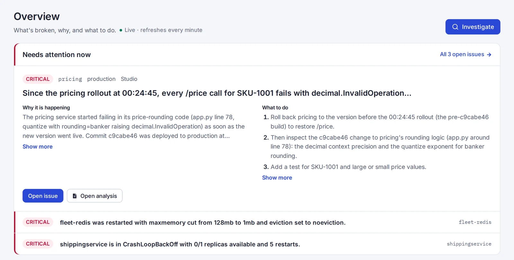

# SerOps

**Open-source, self-hosted AI root cause analysis.** SerOps correlates logs, infrastructure metrics, traces, deploys and code changes to explain why an incident happened, even without an alert. AGPL-3.0.

<picture>
  <source media="(prefers-color-scheme: dark)" srcset=".github/readme/overview-dark.webp">
  
</picture>

[Live demo](https://app.serops.ai) · [Docs](https://serops.ai/docs/) · [Benchmark](https://serops.ai/benchmark) · [Changelog](https://serops.ai/docs/changelog/)

**Benchmark:** the right root cause on 27 to 29 of 30 unseen synthetic incidents over three rounds, and on 66 of 84 analyses across four test estates we built on real clusters. Every miss is shown: [method and results](https://serops.ai/benchmark).

## Try it in one command

```bash
git clone --depth 1 https://github.com/getserops/serops.git && serops/deploy/demo/demo.sh
```

Then open http://localhost:8080 and click **Try the live demo**. It starts SerOps with Docker Compose and loads the same data as the [live demo](https://app.serops.ai): 14 analyses from our benchmark runs on test environments, shown under a fictional organisation name. You can read each root cause, the reasoning behind it, and the logs, deploys and diffs it cites. No AI key is needed, nothing leaves your machine, and the demo is read-only. Measured with 1.5.0 on an empty Docker engine: ready in under a minute (39 and 44 seconds in two runs), most of it downloading about 1.1 GB of images. Stop and delete it with `serops/deploy/demo/demo.sh down`.

## What it reads

Runs on Kubernetes (Helm) or Docker Compose and analyses workloads wherever they run — Kubernetes-aware (pods, restarts, OOMKills) but not Kubernetes-only. Complements your existing observability stack rather than replacing it:

- **Logs** — Elasticsearch, OpenSearch, Loki, Splunk, Datadog, AWS CloudWatch, Google Cloud Logging, Azure Log Analytics
- **Metrics** — Prometheus, VictoriaMetrics, Grafana Mimir, Datadog, AWS CloudWatch, Google Cloud Monitoring, Azure Monitor. SerOps reads CPU and memory from each; from Prometheus, Mimir and VictoriaMetrics also CPU throttling, kube-state-metrics (restarts, rollouts, replicas) and JVM garbage collection. It does not query request-rate, error-rate or latency metrics: errors and slowness are read from logs and traces ([details](https://serops.ai/docs/user-guide/metrics/#what-serops-reads)).
- **Traces** — built-in OTLP receiver, Jaeger, Zipkin, Grafana Tempo, Datadog APM
- **Code & CI/CD** — GitHub, GitLab, Bitbucket, Azure DevOps, Jenkins; deployments from Argo CD and Flux

SerOps watches the signals you already produce, correlates them, and asks a large language model to explain *why* an incident happened. It is alert-agnostic: it surfaces issues even when nobody set up an alert for them.

## Try the benchmark yourself

The [RCA benchmark](https://serops.ai/benchmark) runs on any SerOps install, the demo included, with your own AI key. The key is read from an environment variable for this run only:

```bash
cd serops/deploy/demo
RCA_API_KEY=your-key docker compose exec -e RCA_API_KEY backend \
  python manage.py rca_benchmark --provider claude --set held_out_v2 --budget-usd 2
```

This scores the 30 unseen incidents and 2 healthy windows that the headline figure on /benchmark comes from, for about $1 with Claude Sonnet 5.5. `--provider` takes the provider name as in Settings (`claude`, `gemini`…); `--budget-usd` stops the run once that much is spent. Method and options: [RCA benchmark in the docs](https://serops.ai/docs/development/rca-benchmark/).

## Repository layout

```
serops/
├── backend/     # Django 5 + Celery + PostgreSQL + Redis — REST API and workers
├── frontend/    # React 19 + Vite + Bootstrap — the dashboard
├── docs/        # MkDocs Material — https://serops.ai/docs
└── deploy/
    ├── demo/           # one-command local demo (read-only example data)
    ├── quick-start/    # docker-compose self-host (about 10 minutes)
    └── helm/serops/    # Kubernetes Helm chart
```

## Install

**Docker Compose (single node):**
```bash
git clone https://github.com/getserops/serops.git
cd serops/deploy/quick-start
cp .env.example .env  # edit domain + secrets
docker compose up -d
```

**Kubernetes (Helm)** — lab install with bundled Postgres + Redis; for
production pass `database.url` / `broker.url` instead (see the
[Helm guide](https://serops.ai/docs/deployment/helm/)):
```bash
helm install serops oci://ghcr.io/getserops/charts/serops \
  --namespace serops --create-namespace \
  --set django.secretKey="$(openssl rand -hex 64)" \
  --set django.encryptionKey="$(openssl rand -base64 32 | tr '+/' '-_')" \
  --set devServices.postgresql.enabled=true \
  --set devServices.redis.enabled=true \
  --set ingress.allowInsecure=true   # lab only: no certificate, plain HTTP
```

**AI provider keys are not set in `.env` or in Helm values.** Add them in the UI after first login under **Settings → AI Providers**. They are stored per organisation and encrypted at rest, so nothing reads `ANTHROPIC_API_KEY` or its siblings from the environment. Similar-incident search uses the same organisation keys: embeddings from your AI provider when it offers them (OpenAI, Gemini, or Ollama `nomic-embed-text`), otherwise a local word-overlap match (see [Incident intelligence](https://serops.ai/docs/how-to/intelligence/)). SerOps needs at least one key — Anthropic, Google Gemini, OpenAI, DeepSeek, or Ollama (keyless, on-prem) — before it can analyse anything.

Full guides in [docs/](docs/) or at https://serops.ai/docs.

## What is in the box

| Component | Description |
|---|---|
| **Django REST API** | Multi-tenant API for projects, services, integrations, batches, issues, chat, audit, settings |
| **Celery workers** | Scheduled batch creation, AI analysis, deployment sync, notifications, retention |
| **AI adapter system** | Pluggable providers (Anthropic Claude, Google Gemini, OpenAI-compatible) with circuit breaker, rate limiter, prompt caching |
| **Integration adapters** | Pluggable log, metric and trace backends, an OTLP trace receiver, SCM, CI/CD and GitOps providers (current list above) |
| **Sentinel** | Cost-controlled AI gating — skips analysis on "quiet" batches based on rolling baselines, and fires on error spikes, deployments, new patterns and trace latency or error spikes (active mode by default; shadow mode analyses every batch) |
| **Recent Resolutions Context** | Resolved issues from the same project become diagnostic hints in future AI prompts |
| **Dashboard** | Role-aware React UI mirroring the backend RBAC matrix, English and French |

## What works today

- Multi-tenant (several organisations per instance) with RBAC (admin / user / viewer) and audit logging
- Log, metric, trace, SCM, CI/CD and GitOps integrations (list above) plus OTLP trace ingestion
- AI batch analysis with cost tracking and Sentinel gating
- Email, Slack, Microsoft Teams, PagerDuty and OpsGenie notifications with routing rules, escalation and digest
- OIDC single sign-on with HttpOnly cookie token handoff
- Knox token auth, password change/reset with full token revocation
- GDPR right-to-erasure (`DELETE /api/auth/account`)
- Regex-based masking of secrets and personal data in every AI call (analysis, chat, re-analysis, CI/CD errors, post-mortems); if masking fails, nothing is sent — see [Data protection](https://serops.ai/docs/security/data-protection/#current-limits)

## What does not work yet

- Two-factor authentication
- Inbound Slack / Teams interactions (acknowledge from chat)
- Discord channel

See [ROADMAP.md](ROADMAP.md) for the full picture. Everything above,
and every item in this list once it ships, is in SerOps Community.

## Community and the paid licenses

Community is free in production, under the AGPL, with no limit on users,
projects, services or data. A paid license is needed only for a production
installation that uses the paid features, or when your organisation cannot
use AGPL software. A paid license only adds to Community: nothing is ever
moved out of it ([open source promise](https://serops.ai/docs/open-source-promise/)).

One thing is counted: installations. One license covers one installation (one
SerOps database with its high-availability replicas and its disaster-recovery
standby). Users, employees, projects, services, clusters and data are never
counted, and nothing is counted or limited in the product.

| Plan | For | Price |
|---|---|---|
| Community | Any team, free in production | Free (AGPL-3.0) |
| Business | Organisations that sign the standard terms as they are | €7,500 a year per installation (€625 a month, billed yearly) |
| Enterprise | Buyers who need anything changed or added | Quoted to your scope, minimum €30,000 a year |

Business and Enterprise include the same features, with a commercial license for
internal use and support, and the standard
[security pack](https://serops.ai/docs/legal/security-pack/). Details and the
rules: [pricing](https://serops.ai/pricing).

In every paid license today:

- custom roles and per-project access (since 1.3.0);
- SAML 2.0 single sign-on, from Entra ID, Okta, Keycloak or any SAML identity provider
  (since 1.4.0);
- SCIM 2.0 provisioning: accounts, roles and teams follow the identity provider, and people
  who leave are signed out at once (since 1.4.0);
- real-time audit streaming to a SIEM, over syslog with TLS or HTTPS (Splunk, Datadog,
  Elastic) (since 1.4.0).

OpenID Connect sign-in, with the same group-to-role and group-to-team rules, stays in
Community. Planned next: delegated administration across organisations and compliance
reports. Cloud is planned for 2027.

## Community

Questions, ideas and setups you want to share:
[GitHub Discussions](https://github.com/getserops/serops/discussions). Bugs go in
[issues](https://github.com/getserops/serops/issues).

## Contributing

See [CONTRIBUTING.md](CONTRIBUTING.md) — it covers all three components, including
per-component dev setup and test commands. Security issues go through
[SECURITY.md](SECURITY.md), never a public issue.

## License

AGPL-3.0. See [LICENSE](LICENSE). The two `ee/` directories, `backend/ee/` and
`frontend/src/ee/`, are the exception: they are under the
[SerOps Enterprise License](backend/ee/LICENSE), need a license key to run,
and SerOps is complete without them. Delete them and you have the Community
edition under the AGPL only. Every Community feature stays in Community, forever:
see our [open source promise](https://serops.ai/docs/open-source-promise/).

Commercial licenses available for AGPL-policy-conflict organisations — see [LICENSE-COMMERCIAL.md](LICENSE-COMMERCIAL.md) and [docs/src/license.md](docs/src/license.md).
