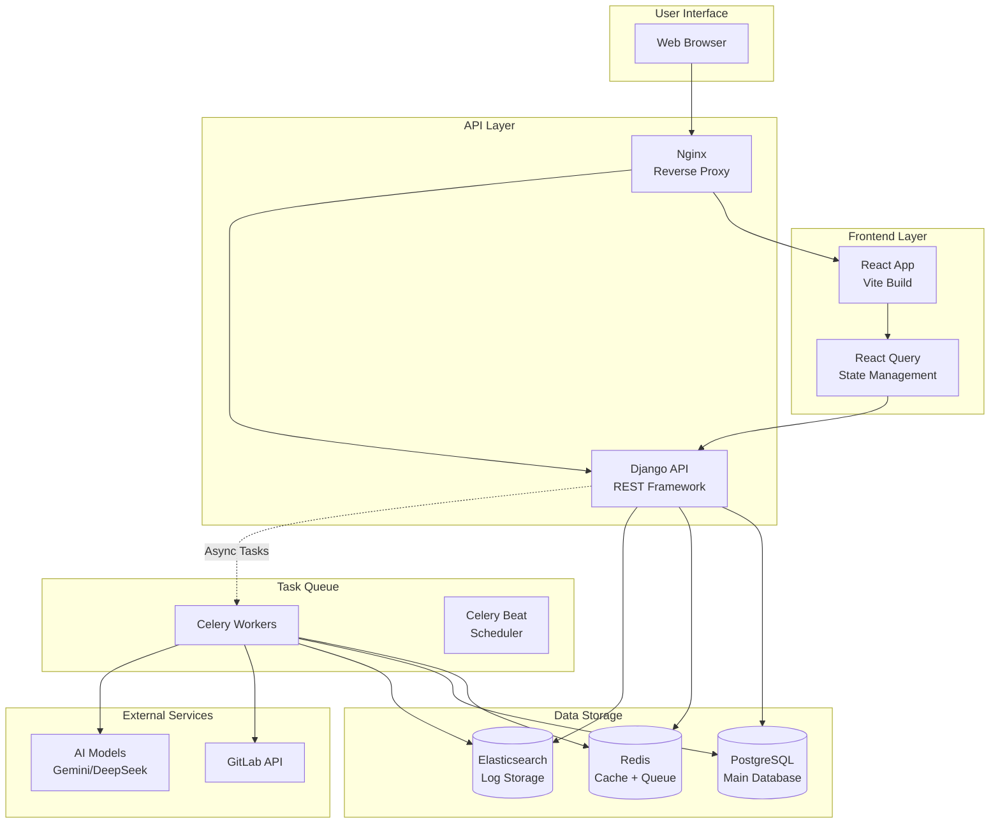

# SerOps Principles & Architecture

**Goal**: Technical foundation, architecture, and design standards for SerOps.

---

## 1. System Architecture

### High-Level Overview

SerOps is an AI-powered incident detection and resolution platform. It connects to your existing observability, SCM, and CI/CD tools — correlating logs, metrics, code changes, and deployments across multiple environments to automatically detect issues and trace them to their root cause.



### Component Details

| Component | Technology | Purpose |
|-----------|------------|---------|
| **Frontend** | React 19 + Vite | SPA with React Query for state management and Recharts for visualization. |
| **API Layer** | Django 5 + DRF | REST API handling auth, business logic, and data orchestration. |
| **Task Queue** | Celery + Redis | Handles async operations: batch creation, log analysis, and GitLab syncing. |
| **Datastore** | PostgreSQL 14 | relational data: Users, Projects, Batches, Issues, Deployments. |
| **Log Store** | Elasticsearch 8 | High-volume storage for application and CI/CD logs. |
| **Cache** | Redis 7 | API response caching, rate limiting, and session storage. |

### Data Flow

#### Batch Analysis Pipeline
1.  **Trigger**: Periodic task (Celery Beat) every 10 minutes.
2.  **Collection**: Fetch logs (ES), metrics (DB), and deployments within the time window.
3.  **Filtration**: Data is strictly filtered by **Environment** (Dev/Staging/Prod).
4.  **Analysis**: Aggregated text sent to AI Model (Gemini/DeepSeek).
5.  **Result**: Structured issues and root causes saved to PostgreSQL.

---

## 2. Core Concepts

### Environment Isolation
Data is strictly isolated at the storage and query level:
-   **Logs**: Enriched with `environment` tag in Elasticsearch.
-   **Deployments**: Tracked in `gitlab_deployment` with `environment` field.
-   **Batches**: Created per-environment.
-   **UI**: Dashboard global filter defaults to 'Production'.

### AI Analysis & Correlation
The core value prop is correlating disparate data points:
-   **Temporal Correlation**: Matching logs to code changes based on *Deployment Time*, not Commit Time.
-   **Contextual Analysis**: AI receives a context window containing logs + recent code changes + health metrics.

### Data Protection & Redaction
*Key Principle: No sensitive PII/Secrets sent to AI.*

The **Redaction Service** intercepts data before it leaves the security boundary:
1.  **Scanning**: Regex-based detection for emails, IP addresses, API keys (AWS, Stripe, generic tokens).
2.  **Masking**: Sensitive strings replaced with `[REDACTED: EMAIL]`.
3.  **Reporting**: A `RedactionReport` is generated for every batch, tracking what was masked for compliance auditing.

---

## 3. Standards & Best Practices

### API Design
-   **Style**: RESTful resources (Nouns for resources, Verbs for actions).
-   **Common Response Envelope**:
    ```json
    {
      "results": [...],
      "count": 42,
      "next": "...",
      "previous": null
    }
    ```
-   **Error Format**:
    ```json
    { "error": "Short title", "detail": "Verbose description" }
    ```

### and Security Policies
-   **Authentication**: JWT via `django-rest-knox`.
-   **Token Policy**:
    -   **Sliding Expiration**: Tokens valid for 10 hours initially.
    -   **Auto-Refresh**: Extended automatically on activity up to 7 days maximum.
    -   **Hard Limit**: Re-login required after 7 days (Security Standard).
-   **Network**: All internal components (DB, Redis, ES) isolated in Docker network; only Nginx exposes ports 80/443.

### Scalability
-   **Async-First**: Any operation taking >500ms should be offloaded to Celery.
-   **Log Retention**: Elasticsearch indices rotate every 30 days (default).
-   **Rate Limiting**: 100 requests/minute per user to prevent abuse.

---

## 4. Data Model

### Core Schema
-   `Project` 1:N `ProjectService` (Links to GitLab/GitHub)
-   `Project` 1:N `AIAnalyzedBatch`
-   `AIAnalyzedBatch` 1:N `Issue`

### Deployment Tracking
This is the linchpin of the logic:
```sql
CREATE TABLE gitlab_deployment (
    code_change_id INT, -- What code
    environment VARCHAR, -- Where it went
    deployed_at TIMESTAMP, -- When it went live
    status VARCHAR -- Did it succeed?
);
```
Unlikes typical systems that track commits, SerOps tracks **Deployments**. This allows querying: *"What code was running in Production when this error occurred?"*

### Extensibility (Providers)
Supported via polymorphic design:
-   `SCM_PROVIDER_CHOICES`: GitLab, GitHub, Bitbucket.
-   `ProjectService.provider_config`: JSON field for provider-specific settings (Repo ID, Webhook secrets).
