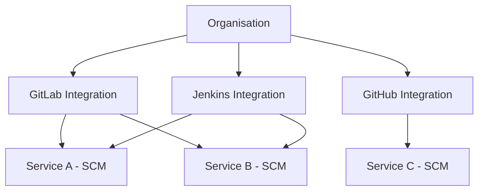

# Integrations

Manage your organisation's SCM and CI/CD provider connections from a central location.

## Overview

**Location**: Integrations (sidebar)

Integrations store credentials and configuration for connecting to external providers like GitLab, GitHub, Jenkins, and Azure DevOps. Once configured, these integrations can be used by any project in your organisation.



---

## Integration Cards

Each integration is displayed as a card showing:

| Element | Description |
|---------|-------------|
| **Provider Icon** | Visual identifier (GitLab, GitHub, etc.) |
| **Name** | Your custom name for this integration |
| **URL** | Provider URL or "Using default" |
| **Status** | Connection status with timestamp |
| **Capabilities** | 📂 SCM, 🔄 CI/CD, 🚀 Deployments |
| **Usage** | Number of services using this integration |

### Connection Status

| Status | Meaning |
|--------|---------|
| 🟢 **Connected** | Verified and working |
| 🟡 **Unverified** | Not yet tested |
| 🔴 **Failed** | Last verification failed |

---

## Adding an Integration

1. Click **+ Add Integration**
2. Select provider from the grid:
   - GitLab, GitHub, Bitbucket, Azure DevOps, Jenkins
3. Fill in the configuration:
   - **Name**: Identifier (e.g., "Corporate GitLab")
   - **URL**: Provider URL (leave blank for cloud defaults)
   - **Access Token**: API token with required scopes

### Token Generation Links

Each provider field includes a **Generate token ↗** link that opens the provider's token creation page.

### Test Connection

Before saving, click **Test Connection** to verify your credentials work. This validates:
- API access
- Token permissions
- Network connectivity

---

## Integration Actions

Click the **⋮** (kebab menu) on any integration card:

| Action | Description |
|--------|-------------|
| **Edit** | Modify name, URL, or credentials |
| **Sync Now** | Force refresh connection status |
| **Delete** | Remove integration (breaks linked services) |

### Verify Connection

Click **Verify Connection** to test the integration. This updates the "Connected X ago" timestamp.

---

## Provider Capabilities

| Provider | SCM | CI/CD | Deployments |
|----------|-----|-------|-------------|
| **GitLab** | ✅ | ✅ | ✅ |
| **GitHub** | ✅ | ✅ | ✅ |
| **Azure DevOps** | ✅ | ✅ | ✅ |
| **Bitbucket** | ✅ | ✅ | ❌ |
| **Jenkins** | ❌ | ✅ | ❌ |

---

## Using Integrations in Services

After creating a global integration, it becomes available in the **Add Service Wizard**:

1. Create a new service in any project
2. In Step 2 (Configure Details), select **Integration** dropdown
3. Choose your configured integration
4. Select repository from the populated list

---

## Usage Statistics

Each integration card shows how many services are using it:

```
Used by 3 services
```

Click to see which services are linked.

---

## API Reference

### List Integrations
```
GET /api/providers/integrations/
```

### Create Integration
```
POST /api/providers/integrations/
{
  "name": "Corporate GitLab",
  "provider_type": "gitlab",
  "base_url": "https://gitlab.company.com",
  "credentials": {
    "access_token": "glpat-xxx"
  }
}
```

### Test Connection (Before Saving)
```
POST /api/providers/integrations/test/
{
  "provider_type": "gitlab",
  "base_url": "https://gitlab.company.com",
  "access_token": "glpat-xxx"
}
```

### Verify Existing Integration
```
POST /api/providers/integrations/{id}/verify/
```

### Get Usage Statistics
```
GET /api/providers/integrations/{id}/usage/
```

### Sync Integration
```
POST /api/providers/integrations/{id}/sync/
```

### Delete Integration
```
DELETE /api/providers/integrations/{id}/
```

---

## Troubleshooting

| Issue | Solution |
|-------|----------|
| "Invalid token" | Regenerate token with correct scopes |
| "Connection refused" | Check URL and network access |
| "SSL certificate error" | Verify self-signed cert is trusted |
| "Rate limited" | Wait or use organisation-level token |
| "Services still using" | Remove service bindings first |
