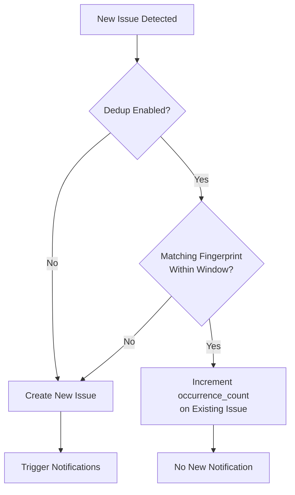

# Issue Settings

Configure how SerOps handles issue deduplication, muting, and auto-resolution at the organisation level.

## Overview

Issue Settings control noise reduction behaviour across your organisation. These settings apply to all projects and determine how SerOps groups similar issues, how long muted issues stay silent, and whether old issues are automatically resolved.

Access these settings via **Settings > Issue Settings**.

## Configuration Options

### Deduplication

When enabled, SerOps groups issues with the same fingerprint to avoid creating duplicate entries.

| Setting | Default | Options | Description |
|---------|---------|---------|-------------|
| **Deduplication Enabled** | `true` | On / Off | Skip creating duplicate issues that match an existing fingerprint |
| **Deduplication Window** | `7 days` | 7, 14, 30, 90, or Forever (0) | How long to remember issue fingerprints for dedup matching |

!!! tip "Choosing a Dedup Window"
    - **7 days** — Best for fast-moving teams with frequent deploys. Issues reappearing after a week are treated as new.
    - **30 days** — Balanced setting for most teams.
    - **90 days / Forever** — For compliance-heavy environments where you want maximum grouping.

### Muting

When an issue is muted, notifications are suppressed for the configured duration.

| Setting | Default | Options | Description |
|---------|---------|---------|-------------|
| **Default Mute Duration** | `7 days` | 1, 7, 30, or Forever (0) | Default duration when a user clicks "Mute" on an issue |

!!! note
    Individual mute actions can override the default duration. The setting controls the pre-selected value in the mute dialog.

### Auto-Resolution

Automatically resolve issues that have not been detected for a specified number of days.

| Setting | Default | Options | Description |
|---------|---------|---------|-------------|
| **Auto-Resolve Enabled** | `false` | On / Off | Automatically resolve stale issues |
| **Auto-Resolve After** | `7 days` | Any positive integer | Days without detection before an issue is auto-resolved |

!!! warning
    Enabling auto-resolve means issues may close without human review. This is best suited for non-critical environments or teams that triage issues daily.

### Recent Resolutions Context

When enabled, SerOps passes recently resolved issues from the same project to the AI as diagnostic context during batch analysis and chat. The AI uses them as hints about the project's recent failure modes — recurring issues get diagnosed faster.

| Setting | Default | Options | Description |
|---------|---------|---------|-------------|
| **Recent Resolutions Enabled** | `true` | On / Off | Inject resolved-issue root causes into AI analysis as context |
| **Window** | `90 days` | 30 / 60 / 90 / 180 / 365 days | How far back to look for resolved issues |
| **Max Resolutions Per Analysis** | `3` | 1 / 2 / 3 / 5 / 10 | Token budget — cap on how many resolutions are passed per AI call |

**Selection criteria.** A resolved issue is eligible for context if it matches *all* of:

- Same organisation as the current batch
- Same project as the current batch
- Status is `RESOLVED`
- `resolved_at` is within the configured window
- `root_cause` is at least 30 characters (quality filter — drops "fixed", "n/a", etc.)

The most recent matches are picked first, preferring the same environment as the current batch (e.g., production memories for a production analysis) and falling back to other environments to fill remaining slots.

!!! info "v1 scope"
    This is a recency-based feature, not a similarity-based one. The AI receives the most recent eligible resolutions for the project, not the most semantically similar to the current batch. A future iteration will add similarity ranking (PostgreSQL full-text search or pgvector). For projects with few resolutions, recency is a reasonable proxy for relevance.

!!! tip "Resolution quality matters"
    The value of this feature depends on how descriptive the `root_cause` field is on resolved issues. A one-word root cause like "fixed" is filtered out automatically. Encourage engineers to leave a sentence or two when resolving — that text becomes the AI's working memory for the project.

## How Deduplication Works

When a new issue is detected during batch analysis:

1. SerOps generates a **fingerprint** based on the issue type, component, and root cause
2. It searches for existing open issues with the same fingerprint within the dedup window
3. If a match is found, the existing issue's `occurrence_count` is incremented instead of creating a new issue
4. If no match is found, a new issue is created



## API Reference

### Get Issue Settings

```
GET /api/settings/issues/
```

### Update Issue Settings

```
PUT /api/settings/issues/
{
  "dedup_enabled": true,
  "dedup_window_days": 30,
  "default_mute_duration_days": 7,
  "auto_resolve_enabled": true,
  "auto_resolve_after_days": 14,
  "memory_enabled": true,
  "memory_window_days": 90,
  "memory_max_items": 3
}
```

**Validation:**

- `memory_window_days` must be between 1 and 730 (two years)
- `memory_max_items` must be between 0 and 10 (set to 0 to disable injection while keeping the feature enabled)

## Related Pages

- [Issues User Guide](../user-guide/issues.md)
- [Tune Issue Deduplication](../how-to/tune-deduplication.md)
- [Issues API](../api/issues.md)
