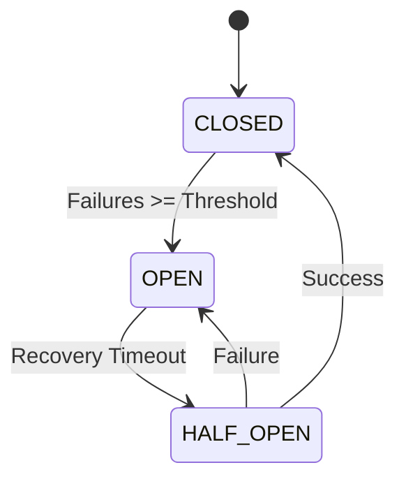

# AI Resilience

SerOps implements robust fault tolerance for AI provider integrations using industry-standard patterns. This page covers the circuit breaker mechanism, rate limiting strategy, smart fallback routing, and the modular AI plugin system that supports multiple providers.

---

## Circuit Breaker Pattern

Prevents cascading failures when an AI provider becomes unavailable:



| State | Behavior |
|-------|----------|
| **CLOSED** | Normal operation, requests flow through |
| **OPEN** | All requests blocked, fail-fast to fallback |
| **HALF_OPEN** | One test request allowed to check recovery |

## Rate Limiting

Proactive throttling prevents hitting provider quotas:

- **Sliding Window**: Tracks requests per minute/hour
- **Burst Allowance**: Permits short bursts above limit
- **Per-Org Tracking**: Optional isolation per organisation

## Smart Fallback

When the primary provider is unavailable, requests automatically route to the configured fallback provider:

```
Request → Rate Check → Circuit Check → Primary Provider (configurable)
                            ↓ (if OPEN)
                       Fallback Provider (configurable)
```

## AI Plugin System

To support diverse AI providers (Gemini, DeepSeek, Claude, local LLMs), SerOps uses a modular **Adapter Pattern**.

### Architecture
The system decouples the core logic from specific provider implementations:
1.  **AIModelProvider (DB)**: Stores configuration (name, base_url, adapter_class).
2.  **BaseProviderAdapter**: Abstract interface defining the contract (`generate`, `normalize_error`).
3.  **AdapterRegistry**: Dynamically loads adapter classes at runtime based on the DB configuration.

```python
# Conceptual Flow
provider_conf = AIModelProvider.objects.get(name='claude')
adapter_class = AdapterRegistry.get_adapter(provider_conf.adapter_class)
adapter = adapter_class(api_key=..., config=...)
response = adapter.generate(prompt, config=..., api_key=...)
```

### Supported Adapters
-   `GeminiAdapter`: Native Google Gemini integration.
-   `ClaudeAdapter`: Native Anthropic SDK integration (`anthropic` library). Defaults to `claude-sonnet-4-20250514`; override via `default_model` in the provider's DB config.
-   `GenericOpenAIAdapter`: Compatible with **OpenAI**, **DeepSeek**, **Mistral**, and **Ollama** (local) via the OpenAI-compatible API.

## Recent Resolutions Context

When a batch is analyzed, SerOps optionally injects recently resolved issues from the same project into the AI prompt as diagnostic context. This gives the model a sense of the project's recent failure modes without adding any new infrastructure (no vector DB, no external embedding service).

```
[Batch logs + metrics + correlations]   ← evidence
[Recent Resolutions Context]            ← interpretation hints (this section)
[Sentinel decision]                     ← gating context
[Analysis question]                     ← the ask
```

**Selection** (per-organisation, configurable):

1. Filter resolved issues to the same project + organisation, within the configured window (default 90 days), with a `root_cause` of at least 30 characters
2. Prefer matches in the same environment as the current batch; fall back to other environments to fill remaining slots
3. Cap at `memory_max_items` (default 3) so the prompt stays bounded

The feature is alert-agnostic and recency-based in v1 — relevance ranking via PostgreSQL full-text search or pgvector is a planned upgrade. See [Issue Settings](../admin/issue-settings.md#recent-resolutions-context) for configuration.

## Admin Monitoring

See [AI & Chat API](../api/ai.md) for monitoring and manual control endpoints.

---

## Related Pages

- [System Overview](overview.md) -- High-level architecture and core concepts
- [Data Model](data-model.md) -- AIModelProvider and adapter configuration storage
- [AI Chat](../user-guide/ai-chat.md) -- User-facing AI chat feature
- [Batches](../user-guide/batches.md) -- How AI analysis produces batches and issues
- [API Reference](../api/overview.md) — Full API documentation including AI endpoints
- [Observability Providers](../integrations/observability-overview.md) — Monitoring AI provider health
