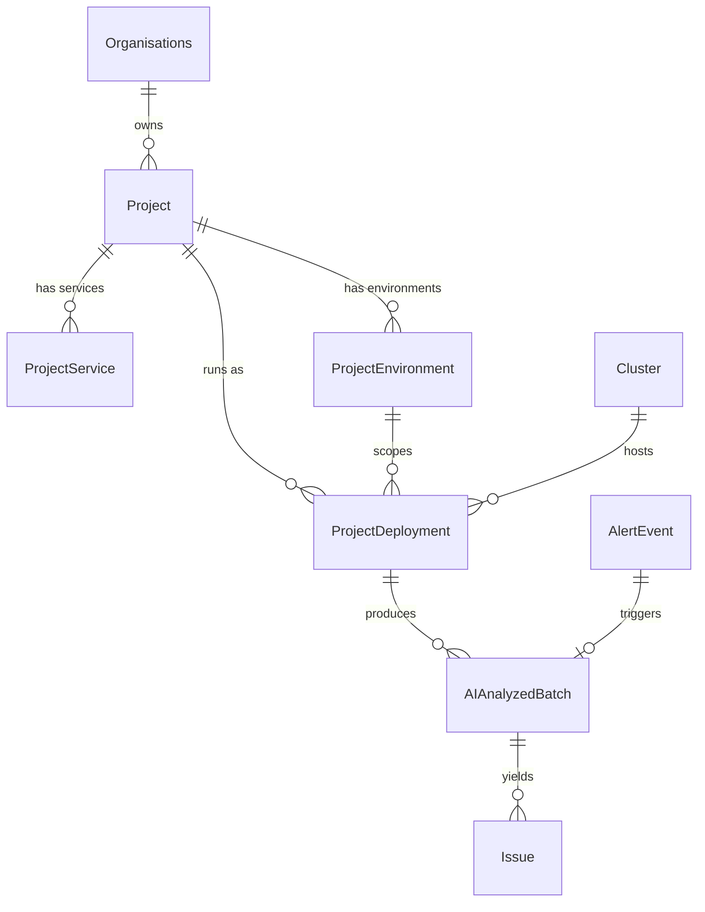
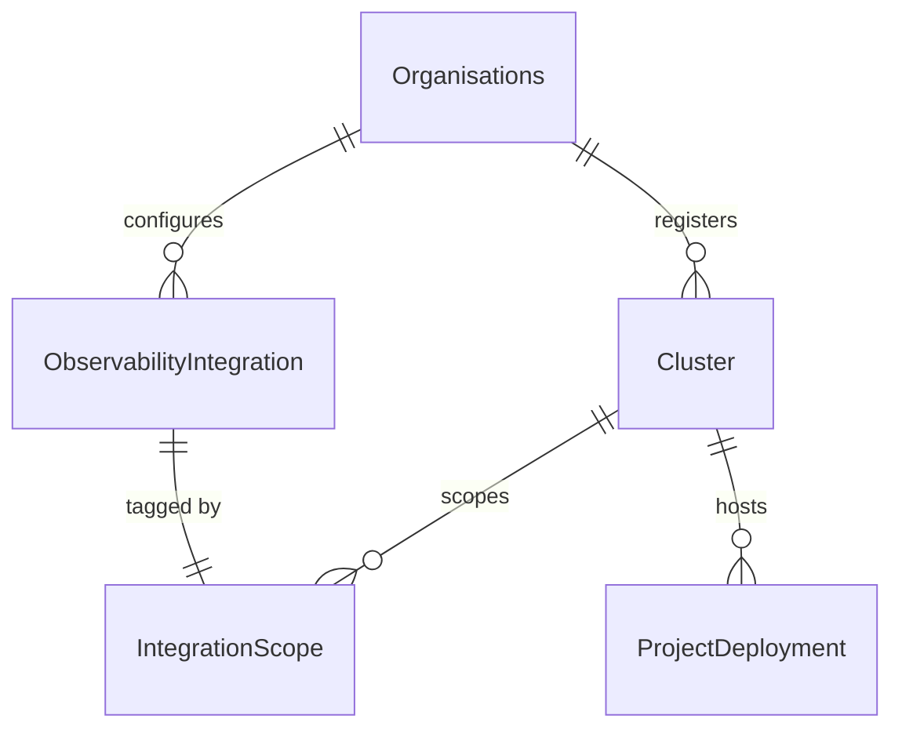
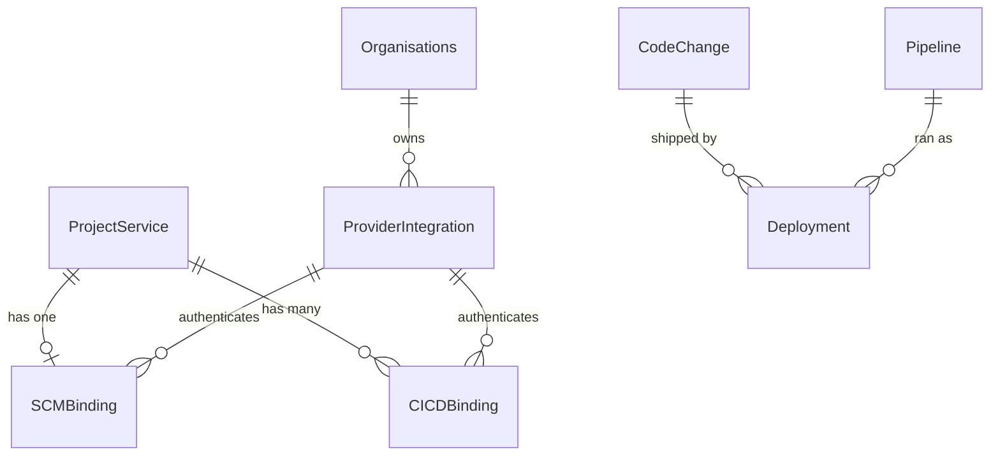
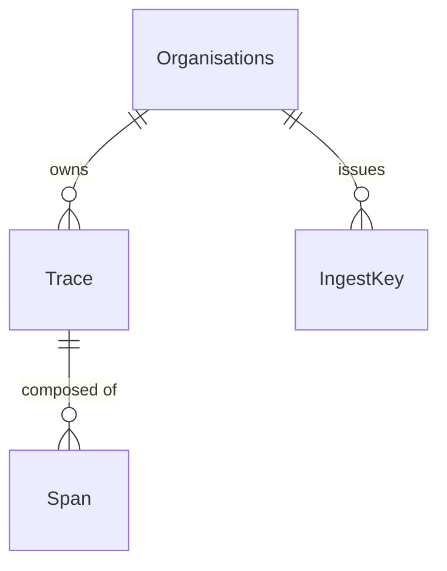
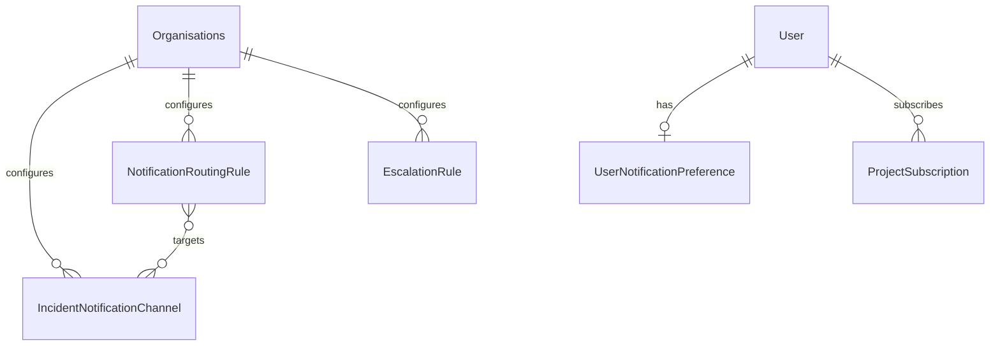

# Data Model

This page describes the relational schema behind SerOps: how a project's
physical topology is represented, how analysis results hang off it, and how
the provider and notification layers stay extensible without schema churn.

The organising idea is that **deployments, not projects, are the unit of
analysis**. A project is a logical thing ("checkout API"); a deployment is a
place it actually runs ("checkout API, production, in `prod-eks`, region
`us-east-1`, namespace `payments`"). Batches are produced per deployment, so
a multi-region service gets one independent analysis per region instead of
one blurred average across all of them.

---

## The analysis path

This is the spine of the product. Everything else attaches to it.

| Model | App | What it represents |
|---|---|---|
| `Organisations` | `Organisations` | Tenant boundary. Every other model reaches one, directly or by traversal. |
| `Project` | `Projects` | A logical system under analysis. |
| `ProjectService` | `Projects` | A microservice or app inside a project. Typed `application` / `infrastructure` / `custom`. |
| `ProjectEnvironment` | `Projects` | A named environment (`production`, `staging`) with branch/tag patterns and the log label value used to query it. |
| `ProjectDeployment` | `Projects` | **One row per (environment × cluster × region × namespace).** The unit batches are generated for. |
| `AIAnalyzedBatch` | `Data` | One analysis run over a time window of telemetry for one deployment. |
| `Issue` | `Data` | A de-duplicated finding produced by a batch. |
| `AlertEvent` | `Data` | An inbound alert from Alertmanager / Grafana / Datadog, optionally linked to the batch it triggered. |

### Why `ProjectDeployment` exists

Before it, a batch was keyed on the implicit tuple `(project × active environment)`.
That cannot express a service deployed to three regions, or the same
environment split across two Kubernetes namespaces — teams worked around it by
duplicating the whole project, which then duplicated every integration and
every issue history alongside it.

`ProjectDeployment` composes four orthogonal dimensions, each optional:

| Field | Nullable | Why |
|---|---|---|
| `environment` | Yes | Legacy projects with zero active environments still get one deployment row, so migration strands nobody. New deployments always set it. |
| `cluster` | Yes | VM, bare-metal and Docker Swarm shops have no cluster concept. This is the majority case for smaller installs. |
| `region` | Free text | Real labels are `us-east-1`, `dc1`, `dr`, `primary` — no fixed enum survives contact with actual infrastructure. |
| `namespace` | Free text | Kubernetes namespace. A database `CheckConstraint` requires `cluster` to be set, because a namespace cannot exist without one. |

A `UniqueConstraint` on all five fields (`project` plus the four dimensions)
makes exact-shape duplicates impossible, while still allowing the same
`(project, environment)` pair to appear repeatedly when cluster, region, or
namespace differ — which is precisely the multi-region case the old model
could not represent.

!!! note "Progressive disclosure"
    Projects with one deployment never see the concept — the UI hides the
    Deployments tab entirely. Small installs get the simpler mental model;
    the schema still supports the complex one when it's needed.

### Batch and issue detail

`AIAnalyzedBatch` carries more than the analysis text. It records the Sentinel
triage decision (`sentinel_decision`, `sentinel_triggers`, `ai_skipped`), the
funnel counters that explain how many logs survived each filtering stage
(`logs_raw_count` → `logs_after_severity_filter` → `logs_unique_patterns` →
`logs_sent_to_ai`), token spend, and an `analysis_history` JSON list holding
results from other models for side-by-side comparison.

`Issue` carries the de-duplication machinery: a `fingerprint` computed from
issue type, scope, component, environment, error class and error target; an
`occurrence_count` bumped on repeat sightings; and correlation flags
(`has_commit_correlation`, `has_metric_correlation`, `has_cicd_correlation`,
`correlation_confidence`) populated by the correlation engine.

!!! info "Multi-tenancy via direct FK"
    `AIAnalyzedBatch`, `Issue`, `CodeChange` and `Pipeline` each carry a
    direct `organisation` foreign key rather than relying on traversal
    through parent models. Filtering happens on the queryset, not after
    fetching, so a future refactor cannot silently open cross-organisation
    access. See [Multi-Tenancy](multi-tenancy.md).

---

## Observability integrations

Integrations are configured once per organisation and then *scoped* — matched
to the deployments they actually serve — rather than duplicated per project.

`ObservabilityIntegration` holds the provider type, credentials (with
`password` Fernet-encrypted at rest), per-capability adapter class paths, and
resilience settings — `timeout_seconds`, `max_retries`, `rate_limit_per_minute`,
plus `last_health_check` / `last_health_status` for the health indicator in the
UI.

`IntegrationScope` is a 1:1 companion carrying four scope tags: `cluster`,
`environment`, `region`, `namespace`. When a deployment needs a log or metric
provider, `_best_integration()` scores every candidate by specificity in the
order **cluster > environment > region > namespace**, and breaks ties on the
integration's `priority_tier` (`primary` / `fallback` / `tertiary`). If the
winning integration errors, the next tier takes over.

`environment` is deliberately free text rather than a foreign key:
`ProjectEnvironment` is per-project, but an integration scoped to "production"
should apply across every project with an environment of that name.

---

## SCM and CI/CD bindings

The binding models keep source control and pipelines decoupled from each
other, so a team can run GitHub for code and Jenkins for builds without the
schema caring.

`ProviderIntegration` stores encrypted credentials at the organisation level so
one GitHub token serves every service bound to it. `SCMBinding` is 1:1 with a
service (a service has one repository); `CICDBinding` is 1:N (a service can
have separate build, test and deploy pipelines). Both track webhook state
(`webhook_id`, `webhook_secret`, `webhook_configured`) and sync health
(`last_sync_at`, `sync_error`).

`Deployment` in the `providers` app links a `CodeChange` to the `Pipeline` that
shipped it, with `environment`, `deployed_at` and `status`. This is what makes
the correlation engine able to answer *"what code was running in production
when this error started?"* — the question commit-only tracking cannot answer,
because a commit's merge time tells you nothing about when it reached a server.

---

## Distributed traces

`Trace` is keyed on the 32-character W3C trace ID as its primary key, and
denormalises root service, root operation, duration, span count and error-span
count so list views never need to aggregate. `Span` carries the OpenTelemetry
shape — `span_id`, `parent_span_id`, kind, status, plus free-form `attributes`
and `events` JSON.

`IngestKey` authenticates the OTLP receiver. Like every secret in SerOps it is
stored as a SHA-256 hash plus a short display prefix; the plaintext is returned
exactly once at creation. See [Data Protection](../security/data-protection.md).

---

## Notifications

Delivery follows the Grafana / Alertmanager split: **what** to notify is one
table, **who** to notify is another.

`IncidentNotificationChannel` is one uniform table of delivery targets —
`slack`, `teams`, `pagerduty`, `opsgenie` and `email` are all just `kind`
values. Secrets (`webhook_url`, `api_key`) are Fernet-encrypted and never
returned on read.

`NotificationRoutingRule` decides which channels fire. Its matcher fields
(`min_severity`, `environments`, `services`, `event_types`) are AND-ed, with an
empty value meaning "no filter on this axis", and `targets` is a many-to-many
to the channels. The dispatcher walks every active rule, takes the **union** of
matching targets, and de-duplicates — so a channel matched by three rules is
still contacted once.

Personal preferences live on the user, not the organisation:
`UserNotificationPreference` holds quiet hours, digest frequency and severity
filters; `ProjectSubscription` is an explicit per-project opt-in.

---

## Organisation settings

| Model | Purpose |
|---|---|
| `AIModelProvider` | Registry of available providers (Claude, Gemini, OpenAI, DeepSeek, Ollama) with adapter class, rate limits, circuit-breaker config and per-million token pricing. |
| `OrganisationAISettings` | Per-org default and fallback provider, monthly budget and warning threshold. |
| `OrganisationAPIKey` | Per-org provider credentials, Fernet-encrypted. There is deliberately no environment-variable fallback — see [Data Protection](../security/data-protection.md). |
| `SentinelConfig` | Triage thresholds: error-spike multiplier, z-score threshold, max quiet batches, and whether the pre-creation gate may drop batches before they are persisted. |
| `IssueSettings` | De-duplication window, auto-resolve behaviour, and issue-memory retention. |
| `RetentionPolicy` | Batch and audit-log retention, cleanup cadence, and the per-org batch generation interval. |
| `OnboardingStatus` | Wizard progress. Completion is **computed from real database state**, not self-attested, so the wizard reflects reality even when setup happened via the API. |

`ProjectEnvironmentState` (in the `Data` app) is the Sentinel rolling-state
store: exponential moving averages for error rate, memory and CPU, their
standard deviations, known error fingerprints, and counters for how many
batches have passed since the last AI analysis. This is what lets Sentinel
distinguish "unusual" from "normal for this service".

---

## Related Pages

- [System Overview](overview.md) — high-level architecture and design standards
- [Multi-Tenancy & Data Isolation](multi-tenancy.md) — how isolation is enforced
- [Data Protection](../security/data-protection.md) — encryption and redaction
- [Deployments](../user-guide/deployments.md) — working with multi-region topologies
- [Projects](../user-guide/projects.md) — projects and services
- [Code Changes](../user-guide/code-changes.md) — deployment and commit tracking
- [Admin Integrations](../admin/integrations.md) — managing provider integrations
