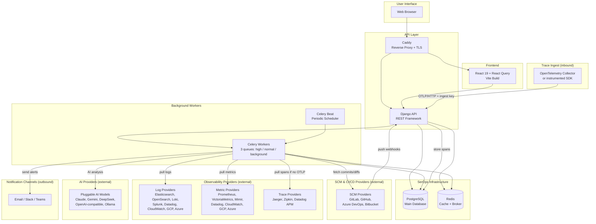

# System Overview

SerOps is an AI-powered incident detection and resolution platform. It connects to your existing observability, SCM, and CI/CD tools — correlating logs, metrics, distributed traces, code changes, and deployments across multiple environments to automatically detect issues and explain their root cause. This page covers the high-level system architecture, core concepts, and the standards that guide development.

---

## 1. System Architecture

### High-Level Overview

SerOps aggregates logs, metrics, distributed traces, and CI/CD data to provide intelligent insights using pluggable AI models (Claude, Gemini, DeepSeek, and any OpenAI-compatible provider).



> **Note:** The self-host quick-start bundles **Caddy** as the reverse proxy — it terminates TLS automatically via Let's Encrypt when `SEROPS_DOMAIN` is a real hostname. Swap it for Nginx / Traefik / a cloud load balancer if your ingress is already handled elsewhere — see `deploy/quick-start/config/caddy/Caddyfile` for the routing rules to replicate. Observability providers are customer-owned — SerOps queries them, it does not
store raw logs or metrics. **Traces are the exception**: spans pushed over OTLP
are stored in SerOps' own PostgreSQL under a retention window you set, because
there is no external system to query them back from. If you would rather keep
traces where they already are, point SerOps at Jaeger, Zipkin or Datadog APM
instead and nothing is stored — see [OTLP Traces](../integrations/traces.md).

### Component Details

| Component | Technology | Purpose |
|-----------|------------|---------|
| **Frontend** | React 19 + Vite | SPA with React Query for state management and Recharts for visualization. |
| **API Layer** | Django 5 + DRF | REST API handling auth, business logic, async tasks, and data orchestration. |
| **Datastore** | PostgreSQL 16 | relational data: Users, Projects, Batches, Issues, Deployments. |
| **Log Store** | Configurable | Elasticsearch, OpenSearch, Loki, Splunk, Datadog, CloudWatch, Google Cloud Logging, or Azure Log Analytics (customer's stack). |
| **Cache** | Redis 7 | API response caching, rate limiting, and session storage. |

### Data Flow

#### Batch Analysis Pipeline

1.  **Trigger**: Periodic internal scheduler at a configurable interval (default:
    10 minutes via `BATCH_GENERATION_INTERVAL`). An alert webhook can also pin an
    explicit window so the analysis covers the period the alert fired in.
2.  **Collection**: Fetch logs, metrics, spans, deployments and CI/CD output for
    the window. Logs and metrics are pulled from the configured providers; spans
    come from the native OTLP store, or from Jaeger / Zipkin / Datadog APM when no
    OTLP data exists. All five use the **same window** — a batch whose metrics
    covered a different period than its logs would invite the AI to correlate
    things that never co-occurred.
3.  **Presence gate**: If the window holds no logs, no metrics *and* no spans, no
    batch is created. Any one of the three is sufficient — a latency regression
    often produces only spans.
4.  **Filtration**: Data is strictly filtered by **Environment**
    (Dev/Staging/Prod), and duplicate log lines collapse into a single entry with
    an occurrence count.
5.  **Preprocessing**: This is where the batch becomes a prompt, and most of the
    cost and privacy control lives here:
    - **Logs** — ERROR / WARNING / CRITICAL lines and error-shaped messages keep
      their slot; a 100-signature aggregation cap stops one noisy loop crowding
      out the rest.
    - **Metrics** — reduced to per-service statistics and sustained-anomaly
      detection rather than raw series. Detection runs per service, because one
      container saturating its limit disappears into a project-wide average.
    - **Traces** — thousands of spans reduce to the slowest and the failing ones,
      plus the services they touched.
    - **Redaction** — emails, tokens and secrets are masked **before** anything
      leaves the security boundary, span summaries included.
    - **Memory** — root causes from recently resolved issues on the same project
      are attached as diagnostic hints.
6.  **Sentinel gating**: The batch is scored against a rolling baseline. A quiet
    batch skips the AI call entirely; rule-based detection still runs, so quiet
    does not mean unexamined.
7.  **Analysis**: The prepared prompt goes to the configured AI model, with
    automatic fallback to a secondary provider. Token usage and cost are recorded
    per call and counted against the organisation's monthly budget.
8.  **Result**: Structured issues and root causes saved to PostgreSQL. Issues are
    deduplicated on a fingerprint, so a recurrence increments an existing issue
    rather than creating a new one, and every sighting is recorded against the
    batch that reported it.

---

## 2. Core Concepts

### Environment Isolation
Data is strictly isolated at the storage and query level:
-   **Logs**: Enriched with `environment` tag in Elasticsearch.
-   **Deployments**: Tracked in the `Deployment` model with `environment` field.
-   **Batches**: Created per-environment.
-   **UI**: Dashboard global filter defaults to 'Production'.

### AI Analysis & Correlation
The core value prop is correlating disparate data points:
-   **Temporal Correlation**: Matching logs to code changes based on *Deployment Time*, not Commit Time.
-   **Contextual Analysis**: AI receives a context window containing logs + recent code changes + health metrics.

### Data Protection & Redaction
*Key Principle: No sensitive PII/Secrets sent to AI.*

The **Redaction Service** intercepts data before it leaves the security boundary:
1.  **Scanning**: Regex-based detection for emails, IP addresses, API keys (AWS, Stripe, generic tokens).
2.  **Masking**: Sensitive strings replaced with `[REDACTED: EMAIL]`.
3.  **Logging**: Redaction activity is logged for compliance auditing.

---

## 3. Standards & Best Practices

### API Design
-   **Style**: RESTful resources (Nouns for resources, Verbs for actions).
-   **Common Response Envelope**:
    ```json
    {
      "results": [...],
      "count": 42,
      "next": "...",
      "previous": null
    }
    ```
-   **Error Format**:
    ```json
    { "error": "Short title", "detail": "Verbose description" }
    ```

### Authentication and Security Policies
-   **Authentication**: Token-based via `django-rest-knox`.
-   **Token Policy**:
    -   **Lifetime**: Tokens valid for 30 days from creation.
    -   **Auto-Refresh**: Automatically extended on each authenticated request (at most once per hour).
    -   **Hard Limit**: Re-login required after 30 days of inactivity.
-   **Network**: All internal components (DB, Redis, ES) isolated in Docker network; only Nginx exposes ports 80/443.

### Scalability
-   **Async-First**: Any operation taking >500ms should be offloaded to Celery.
-   **Log Retention**: Elasticsearch indices rotate every 30 days (default).
-   **Rate Limiting**: Rate limiting can be configured via Django REST Framework throttle classes.

---

## Related Pages

- [Data Model](data-model.md) -- Core schema, deployment tracking, and provider extensibility
- [Multi-Tenancy & Data Isolation](multi-tenancy.md) -- Organisation-level isolation and security guarantees
- [AI Resilience](ai-resilience.md) -- Circuit breaker, rate limiting, and AI plugin system
- [API Reference](../api/overview.md) — Full REST API documentation
- [Data Protection](../security/data-protection.md) -- Redaction and compliance details
- [Authentication](../security/authentication.md) -- Auth flows and token policies
- [Environments](../user-guide/environments.md) -- Environment isolation in practice
