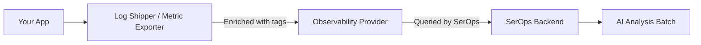

# Configure Data Collection Agents

SerOps does not store logs or metrics itself — it queries your existing observability providers. For SerOps to find, filter, and isolate your data correctly, your log shippers and metric exporters **must** include specific enrichment fields on every record they send.

Without these fields, SerOps cannot:

- Associate logs with the correct project and service
- Isolate data between organisations (multi-tenancy)
- Separate environments (production vs. staging vs. development)
- Generate meaningful batches for AI analysis

!!! tip "Check my data"
    Open **Projects → [your project] → Data** and select **Check my data**. SerOps sends the query the scheduled analysis sends to your log store, one filter at a time, over the last hour, and shows how many logs are left after each step:

    | Step | Logs left |
    |------|-----------|
    | Logs in the places the project reads from (indices, log groups, streams) | every log |
    | Tagged with the project | `project_name` |
    | In the environment, or one of its spellings | `environment` |
    | Errors and warnings | level, or the line itself |
    | From the services the project lists | `service_name`: these are analysed |

    The first step that leaves nothing says what to change. The check also lists the project, environment and service **values** your logs carry (with the field that carried each), and offers two fixes in one click: list a service seen in your errors, or accept the environment value your logs carry (for example `live` for Production).

    The check shows values such as service names, never log messages. Running it needs the *use integrations* permission (users and admins); applying a fix needs *edit projects*.

    The same tab shows what the last scheduled run of each environment did and, when it made no analysis, why: no services listed, no log integration, nowhere to read logs from, no errors in the window, errors only from unlisted services, and so on.

!!! tip "Check field coverage with `check_ingest`"
    To see which field names your records use (rather than the values), run the field coverage report:

    ```bash
    # CLI (from the backend container):
    docker compose exec backend python manage.py check_ingest --integration <ID>

    # or via HTTP:
    GET /api/integrations/observability/<ID>/ingest-health/?minutes=60&limit=100
    ```

    The report lists every canonical field (`service_name`, `project_name`, `environment`, `log_level`, `organisation_name`), how often it's present in the last N records, and which industry-standard aliases (Datadog USM `service`, OpenTelemetry `service.name`, Kubernetes `app`, ...) are covering the gap. Auto-aliased fields still work — the report just makes the coverage visible so you can standardise later if you want.

    See the "Alias support" section below for the full list of accepted alternatives.

---

## How It Works



Your agents enrich each log entry and metric with identifiers (organisation, project, service, environment). SerOps uses these fields as filters when querying your provider, ensuring it retrieves only the relevant data for each batch.

---

## Required Fields for Logs

All log providers use the **same canonical field names**. Configure your log shippers to use these fields regardless of which provider you use.

### Canonical Field Reference

| Field | Required | Description | Example |
|-------|----------|-------------|---------|
| `organisation_name` | Yes | Organisation identifier (matches your org in SerOps) | `myorg` |
| `project_name` | Yes | Project identifier (matches your project in SerOps) | `demo` |
| `service_name` | Yes | Service name (must match a registered ProjectService) | `backend` |
| `environment` | Yes | Environment name | `production` |
| `log_level` | Recommended | Severity level | `ERROR`, `WARN`, `INFO`, `DEBUG` |

### Kubernetes topology mode

If your metrics come from Kubernetes, set the integration's `topology_mode` to `kubernetes`. This flips SerOps' metric queries from node-level (`node_cpu_seconds_total`) to **container-level aggregated by service** (`sum by (service_name)(rate(container_cpu_usage_seconds_total{...}[5m]))`) — so "what's the CPU of the `checkout` service?" gives the right answer regardless of where pods run today.

| Setting | VM mode (default) | Kubernetes mode |
|---------|-------------------|-----------------|
| **Prometheus** metric | `node_cpu_seconds_total`, `node_memory_MemTotal_bytes` | `sum by (service_name)(rate(container_cpu_usage_seconds_total[5m]))`, `sum by (service_name)(container_spec_memory_limit_bytes)` |
| **Datadog** metric | `avg:system.cpu.user`, `avg:system.mem.total` | `avg:kubernetes.cpu.usage.total{...} by {service_name}`, `avg:kubernetes.memory.limits{...} by {service_name}` |
| **CloudWatch** namespace | `AWS/EC2` + `CWAgent` | `ContainerInsights` (`pod_cpu_utilization`, `pod_memory_working_set`) |
| Best for | Bare-metal, VMs, EC2 instances | Kubernetes clusters where pods move |

Kubernetes mode is verified with Prometheus on single-node clusters; the Datadog and CloudWatch columns are not yet validated live. See [Tested environments](../integrations/overview.md#tested-environments).

**Prerequisites for `kubernetes` mode**:

- **Prometheus**: your scrape config must expose `service_name` as a top-level label on container metrics. The recommended `kubernetes_sd_configs` snippet:

    ```yaml
    - job_name: 'kubernetes-pods'
      kubernetes_sd_configs:
        - role: pod
      relabel_configs:
        - source_labels: [__meta_kubernetes_pod_label_app]
          target_label: service_name
        - source_labels: [__meta_kubernetes_namespace]
          target_label: environment
        - target_label: organisation_name
          replacement: <YOUR-ORG>
        - target_label: project_name
          replacement: <YOUR-PROJECT>
    ```

- **Datadog**: enable the Kubernetes integration on the DD Agent (default on DaemonSet installs). Add `DD_TAGS="organisation_name:<YOUR-ORG> project_name:<YOUR-PROJECT>"` to the agent env.

- **CloudWatch (EKS)**: enable Container Insights on the cluster + install the CloudWatch agent DaemonSet. Metrics land in the `ContainerInsights` namespace.

Switch modes in the SerOps UI (Integrations → your metric provider → Topology Mode) or via API (`PATCH /api/integrations/observability/<id>/ topology_mode=kubernetes`). The change takes effect on the next query — no restart required.

### Alias support (Datadog USM, OpenTelemetry, Kubernetes)

If your existing infrastructure already tags data with a common convention, SerOps accepts these alternatives out of the box — no retagging required. The `check_ingest` validator flags which alias (if any) is covering each canonical field.

| Canonical | Accepted alternatives (in precedence order) |
|-----------|---------------------------------------------|
| `service_name` | `service` (Datadog USM), `service.name` (OpenTelemetry, Elastic Common Schema), `app` (Kubernetes), `app.kubernetes.io/name` (Kubernetes standard), `kubernetes.labels.app`, `kubernetes.container_name` (Fluent Bit), `kubernetes.container.name` (Filebeat) |
| `environment` | `env` (Datadog USM), `deployment.environment` / `deployment.environment.name` (OpenTelemetry), `service.environment` (Elastic Common Schema) |
| `log_level` | `level`, `log.level` (Elastic Common Schema), `severity`, `severity_text` (OpenTelemetry), `status` (Datadog log-severity field) |
| `project_name` | `project` |
| `organisation_name` | `organization_name` (US spelling), `org_name` |

Dotted names match whether the record stores them flat (`"service.name": "x"`) or nested (`"service": {"name": "x"}`). Alias-aware query builders emit `bool.should` (Elasticsearch), `OR` (Datadog), `or` (CloudWatch Insights) and `IN` (Splunk) clauses so any tagged record matches. **Grafana Loki is the exception** — its stream selectors AND across labels and can't easily OR the same value against different label names. Loki users must tag with the canonical `service_name` / `project_name` / `environment` names.

**Provider-specific notes:**

- **Elasticsearch / OpenSearch**: Fields are document fields, top-level or nested (Elastic Common Schema). Every level field is queried, whatever its mapping (keyword, text or a number).
- **Grafana Loki**: Fields are stored as stream labels (`project_name`, `service_name`, `environment`, `log_level`).
- **Datadog**: Fields can be **tags** (the Agent's `tags:`, `DD_TAGS`, Unified Service Tagging `env` / `service`) or **log attributes** from JSON bodies (`@project_name`); both are matched. Datadog's native `status` field is also used for severity.
- **AWS CloudWatch**: Fields are stored as JSON fields in structured log entries (`project_name`, `service_name`, `environment`, `log_level`).

!!! warning "Service Name Must Match Exactly"
    The `service_name` value in your logs **must exactly match** a registered `ProjectService` name in SerOps. If the names don't match, logs are silently filtered out and batches will be empty.

### Severity Values

SerOps normalises severity levels. Any case is accepted (`ERROR`, `error`, `Error`):

| Level | Accepted values | Numbers |
|-------|-----------------|---------|
| Error | `ERROR`, `ERR`, `FATAL`, `CRITICAL`, `CRIT`, `ALERT`, `EMERG`, `PANIC`, `SEVERE` | Pino / Bunyan `level` 50 and 60; OpenTelemetry `severity_number` 17+; syslog `severity` 0-3 |
| Warning | `WARN`, `WARNING` | Pino / Bunyan 40; OpenTelemetry 13-16; syslog 4 |
| Info | `INFO`, `NOTICE` | Pino / Bunyan 30; OpenTelemetry 9-12; syslog 5-6 |
| Debug | `DEBUG`, `TRACE` | lower values |

**No level field?** Unstructured logs work too: SerOps reads the level from
the line itself (`2026-10-27 ERROR ...`, `[warn] ...`, `level=error`), and
fetches lines whose text holds an error word (`exception`, `failed`,
`timeout` ...) even when they carry no level.

### Environment Names

Use standard names or their aliases. SerOps queries every spelling of the
environment it analyses, so logs tagged `prod` belong to `production`:

| Environment | Accepted Aliases |
|-------------|-----------------|
| `production` | `prod`, `prd` |
| `staging` | `stage`, `stg`, `preprod` |
| `development` | `dev` |

Logs that use another value (`live`, `prod-eu`) count for an environment once
you accept that value: **Check my data** offers it in one click when it sees
it in your logs. The scheduled analysis then queries that value too.

---

### Projects tagged another way

You do not have to add `project_name` to your logs. If your services are
already grouped another way, tell the project:

| Your logs carry | Project log rule |
|-----------------|------------------|
| OpenTelemetry `service.namespace: shop` | `service.namespace = shop` (or `resource.attributes.service.namespace` as the Collector's Elasticsearch exporter writes it) |
| A Kubernetes namespace per project | `kubernetes.namespace = shop` (Filebeat), `kubernetes.namespace_name = shop` (Fluent Bit), `namespace = shop` (Loki) |
| An `app.kubernetes.io/part-of` or `team` label | `kubernetes.labels.app_kubernetes_io/part-of = shop`, `team = payments` |

A log belongs to the project when it carries `project_name` (or `project`)
equal to the project name **or** matches any of its rules, so a rule only
ever adds logs. A project has up to five rules. Every log store is queried
this way. On Loki the field is a label name (dots become underscores, as
Loki's own OpenTelemetry ingestion writes them: `service_namespace`) and
SerOps runs one query per rule.

The easiest way to set a rule: **Projects → [project] → Data → Check my
data** lists how the logs with no project field are grouped, values equal to
the project name first, with **Use for this project** next to each. The same
place lists the project's rules, with **Remove**.

## Required Labels for Metrics

All metric providers (Prometheus, VictoriaMetrics, Grafana Mimir, Datadog, CloudWatch, Google Cloud Monitoring, Azure Monitor) require labels to scope queries.

### Label Reference

Metric labels use the **same canonical names as log fields** — one vocabulary across data sources. This is a change from earlier releases which used `org_id` / `project_id`; if you have existing scrape configs with those names, rename them to the new canonical form.

| Label | Required | Description | Example |
|-------|----------|-------------|---------|
| `organisation_name` | Yes | Organisation identifier (matches your org in SerOps) | `serops` |
| `project_name` | Yes | Project identifier (matches your project in SerOps) | `demo` |
| `service_name` | Recommended | Service identifier (matches a `ProjectService` name) — enables per-service dashboards | `checkout` |
| `environment` | Yes | Environment name | `production` |
| `serops_type` | Recommended | Host category for discovery (see below) | `server` |
| `hostname` | Recommended | Human-readable host identifier | `api-prod-01` |

SerOps uses these labels as selectors when querying metrics:

```
node_memory_MemTotal_bytes{organisation_name="serops", project_name="demo", environment="production"}
```

Per-service view (with `service_name` on the scrape config):

```
sum by (service_name) (rate(container_cpu_usage_seconds_total{organisation_name="serops", project_name="demo"}[5m]))
```

### Monitored Metrics

SerOps queries these specific metric names (Prometheus naming convention):

| Metric | Purpose |
|--------|---------|
| `node_memory_MemTotal_bytes` | Total system memory |
| `node_memory_MemFree_bytes` | Free memory |
| `node_memory_MemAvailable_bytes` | Available memory |
| `node_cpu_seconds_total` | CPU time (per-core, per-mode) |

For Datadog and CloudWatch, SerOps automatically maps these names to native equivalents (see provider-specific pages).

### `serops_type` Values

The `serops_type` label is used only by **host discovery** — the host picker on the Metrics page. Metric data queries (`node_memory_*`, `node_cpu_*`) work without it. If you omit `serops_type`, metrics will still be collected and displayed, but the host dropdown will be empty.

| Value | Description |
|-------|-------------|
| `server` | Application/infrastructure servers — visible in metrics UI host picker |
| `internal` | Monitoring infrastructure (Prometheus, exporters) — hidden from host picker |

---

## Where SerOps looks for your logs

| Provider | Where | Setting |
|----------|-------|---------|
| Elasticsearch / OpenSearch | SerOps-named indices (`application-logs-<project>*`), else `logs-*`, `filebeat-*`, `logstash-*` | **Index pattern** on the integration, e.g. `logs-*, filebeat-*` |
| AWS CloudWatch | Log groups starting with `/aws/<project>` or containing the project name | **Log groups** on the integration, e.g. `/ecs/shop-api, /aws/lambda/checkout` |
| Splunk | The `main` index | **Index** on the integration |
| Grafana Loki | Streams labelled `project_name="<project>"` | (labels, see below) |
| Datadog, Google Cloud, Azure | The whole account / workspace, filtered by the fields above | none |

Whatever the location, records are still filtered by project and environment,
so a broad index pattern or several log groups are safe.

## Provider-Specific Agent Configuration

### Elasticsearch / OpenSearch (Fluentd)

Add enrichment fields to every log entry using Fluentd's `record_transformer` filter.

```xml
# =============================================================
# Add base metadata to ALL logs tagged with your project prefix
# =============================================================
<filter myproject.**>
  @type record_transformer
  enable_ruby true
  <record>
    organisation_name myorg
    project_name      myproject
    environment       production
    @timestamp        ${Time.now.utc.iso8601(3)}
  </record>
</filter>

# =============================================================
# Add service_name per source (must match ProjectService name)
# =============================================================
<filter myproject.backend>
  @type record_transformer
  <record>
    service_name backend
  </record>
</filter>

<filter myproject.redis>
  @type record_transformer
  <record>
    service_name redis
  </record>
</filter>

# =============================================================
# Extract log_level from message content
# =============================================================
<filter myproject.**>
  @type record_transformer
  enable_ruby true
  <record>
    log_level ${record["message"].to_s.match(/(CRITICAL|FATAL|ERROR|WARN(?:ING)?|INFO|DEBUG)/i)&.[](1)&.upcase || "INFO"}
  </record>
</filter>

# =============================================================
# Output to Elasticsearch
# =============================================================
<match myproject.**>
  @type elasticsearch
  host es.corp.example.com
  port 9200
  user elastic
  password your_password
  index_name application-logs-myproject
  include_timestamp true
  suppress_type_name true

  <buffer tag>
    @type file
    path /fluentd/buffer/app_logs
    flush_mode interval
    flush_interval 15s
    chunk_limit_size 8m
  </buffer>
</match>
```

!!! tip "Filebeat Alternative"
    If you use Filebeat instead of Fluentd, use [processors](https://www.elastic.co/guide/en/beats/filebeat/current/filtering-and-enhancing-data.html) to add the same fields:

    ```yaml
    processors:
      - add_fields:
          target: ""
          fields:
            organisation_name: myorg
            project_name: myproject
            service_name: backend
            environment: production
    ```

### Elasticsearch / OpenSearch (Logstash)

```ruby
filter {
  mutate {
    add_field => {
      "organisation_name" => "myorg"
      "project_name"      => "myproject"
      "environment"       => "production"
    }
  }

  # Set service_name based on source
  if [source] =~ /backend/ {
    mutate { add_field => { "service_name" => "backend" } }
  } else if [source] =~ /redis/ {
    mutate { add_field => { "service_name" => "redis" } }
  }

  # Extract log level
  grok {
    match => { "message" => "(?<log_level>CRITICAL|FATAL|ERROR|WARNING|WARN|INFO|DEBUG)" }
    tag_on_failure => []
  }
  if ![log_level] { mutate { add_field => { "log_level" => "INFO" } } }
}
```

### Grafana Loki (Promtail)

Loki uses **stream labels** for filtering. Add labels in your Promtail `scrape_configs`:

```yaml
scrape_configs:
  - job_name: backend
    static_configs:
      - targets: [localhost]
        labels:
          project_name: myproject
          environment: production
          service_name: backend
          organisation_name: myorg
          __path__: /var/log/backend/*.log
    pipeline_stages:
      - regex:
          expression: '(?P<log_level>CRITICAL|FATAL|ERROR|WARNING|WARN|INFO|DEBUG)'
      - labels:
          log_level:

  - job_name: redis
    static_configs:
      - targets: [localhost]
        labels:
          project_name: myproject
          environment: production
          service_name: redis
          organisation_name: myorg
          __path__: /var/log/redis/*.log
```

### Datadog Agent

Configure tags in your `datadog.yaml` or per-check configuration:

```yaml
# datadog.yaml
tags:
  - "organisation_name:myorg"
  - "project_name:myproject"
  - "environment:production"

# Per-log source in conf.d/
logs:
  - type: file
    path: /var/log/backend/*.log
    service: backend
    source: myapp
    tags:
      - "organisation_name:myorg"
      - "project_name:myproject"
      - "environment:production"
```

Additionally, structure log entries as JSON with canonical fields for rich filtering:

```json
{
  "message": "Connection timeout",
  "log_level": "ERROR",
  "project_name": "myproject",
  "service_name": "backend",
  "environment": "production"
}
```

### AWS CloudWatch Agent

Configure your CloudWatch agent to write structured JSON logs and organise them into log groups:

```json
{
  "logs": {
    "logs_collected": {
      "files": {
        "collect_list": [
          {
            "file_path": "/var/log/backend/*.log",
            "log_group_name": "/serops/application/myorg",
            "log_stream_name": "backend-{instance_id}",
            "timestamp_format": "%Y-%m-%dT%H:%M:%S"
          }
        ]
      }
    }
  }
}
```

Ensure your application writes JSON-structured logs with canonical fields:

```json
{
  "message": "Request processed",
  "log_level": "INFO",
  "project_name": "myproject",
  "service_name": "backend",
  "environment": "production"
}
```

### Prometheus / VictoriaMetrics / Grafana Mimir

Add labels to your `scrape_configs` in `prometheus.yml`:

```yaml
scrape_configs:
  - job_name: node-exporter
    static_configs:
      - targets: ['node_exporter:9100']
        labels:
          organisation_name: 'myorg'
          project_name: 'myproject'
          environment: 'production'
          hostname: 'api-prod-01'
          serops_type: 'server'

  # Monitoring infrastructure — hidden from SerOps UI
  - job_name: prometheus
    static_configs:
      - targets: ['localhost:9090']
        labels:
          organisation_name: 'myorg'
          project_name: 'myproject'
          environment: 'production'
          hostname: 'prometheus'
          serops_type: 'internal'
```

!!! tip "Multiple Servers"
    Add a separate target entry for each server, each with a unique `hostname` label:

    ```yaml
    static_configs:
      - targets: ['10.0.1.10:9100']
        labels:
          organisation_name: 'myorg'
          project_name: 'myproject'
          environment: 'production'
          hostname: 'web-01'
          serops_type: 'server'
      - targets: ['10.0.1.11:9100']
        labels:
          organisation_name: 'myorg'
          project_name: 'myproject'
          environment: 'production'
          hostname: 'web-02'
          serops_type: 'server'
    ```

### Datadog Metrics

Datadog metrics use tags for filtering. Ensure your hosts report with the correct tags in `datadog.yaml`:

```yaml
tags:
  - "organisation_name:myorg"
  - "project_name:myproject"
  - "environment:production"
  - "serops_type:server"
```

SerOps automatically maps Prometheus metric names to Datadog equivalents:

| SerOps queries | Datadog metric |
|---------------|----------------|
| `node_memory_MemTotal_bytes` | `system.mem.total` |
| `node_memory_MemFree_bytes` | `system.mem.free` |
| `node_memory_MemAvailable_bytes` | `system.mem.usable` |
| `node_cpu_seconds_total` | `system.cpu.user` |

### CloudWatch Metrics

SerOps maps metric names to CloudWatch namespaces:

| SerOps queries | CloudWatch namespace/metric |
|---------------|---------------------------|
| `node_memory_MemTotal_bytes` | `CWAgent/mem_total` |
| `node_memory_MemFree_bytes` | `CWAgent/mem_free` |
| `node_memory_MemAvailable_bytes` | `CWAgent/mem_available` |
| `node_cpu_seconds_total` | `AWS/EC2/CPUUtilization` |

Ensure your EC2 instances or CWAgent publish metrics with these dimensions:

- `organisation_name`
- `project_name`
- `environment`
- `InstanceId` (auto-populated by EC2)

---

## Matching Names to SerOps Entities

The enrichment values must match what you configured in SerOps:

| Agent field | Must match | Where to find it |
|-------------|-----------|------------------|
| `organisation_name` | Organisation name (metrics need it exactly) | **Settings > General** |
| `project_name` | Project name | **Projects** page |
| `service_name` | ProjectService name | **Projects > [Project] > Services** |
| `environment` | Environment name | **Projects > [Project] > Environments** |

!!! example "Naming Example"
    If your SerOps setup is:

    - Organisation: **serops**
    - Project: **demo**
    - Services: **backend**, **redis**, **auth**
    - Environments: **production**, **staging**, **development**

    Then your Fluentd config should use `organisation_name: serops`, `project_name: demo`, `service_name: backend`, and `environment: development`.

---

## Verification Checklist

After configuring your agents, verify data is flowing correctly:

- [ ] **Check my data finds logs to analyse**: **Projects → [Project] → Data → Check my data** ends with "Everything is in place" (or "no errors or warnings", which is good news)
- [ ] **Health check passes**: Go to **Integrations → Log Providers** (or **Metric Providers**) and run a health check on your provider
- [ ] **Service names match**: The `service_name` in your logs exactly matches a service registered under your project
- [ ] **Environment names match**: The `environment` in your logs matches an enabled environment in your project settings (or a known alias)
- [ ] **Logs are queryable**: Check your provider directly (Kibana, Grafana, Datadog UI) to confirm enriched fields are present on log entries
- [ ] **Metrics have labels**: Query Prometheus/VictoriaMetrics directly to verify `organisation_name`, `project_name`, `environment` labels exist on `node_*` metrics
- [ ] **Batches appear**: Navigate to **Analyses** in SerOps — batches should appear within the configured generation interval (default: 60 seconds)

---

## Troubleshooting

| Symptom | Likely Cause | Solution |
|---------|-------------|----------|
| No batches appear | See **Projects → [Project] → Data** | The last scheduled run of each environment says why it made no analysis; **Check my data** shows the step where logs drop out |
| No batches appear | `service_name` mismatch | Compare the service name in your logs with the registered ProjectService name (upper and lower case do not matter); **Check my data** lists the services in your logs and lists them in the project in one click |
| No batches appear | `project_name` mismatch | Project names are matched exactly, including case; **Check my data** lists the project values your logs carry |
| Empty batches (no logs) | Missing enrichment fields | Check your log provider directly for the presence of `project_name`, `service_name`, `environment` fields |
| Wrong environment on batches | Environment name not matching | Verify your agent writes a standard environment name (`production`, `staging`, `development`) or a known alias |
| Metrics page shows no hosts | Missing `serops_type: server` label | Ensure your Prometheus scrape target has `serops_type: 'server'` — `internal` targets are hidden from the UI |
| Metrics page shows no data | Missing required labels | Query Prometheus directly: `node_memory_MemTotal_bytes{organisation_name="yourorg"}` — if empty, labels are not set |
| Logs from one org appear in another | Incorrect `organisation_name` | Each organisation must use a unique identifier consistently across all agents |

---

## Related Pages

- [Connect Your First Provider](connect-provider.md) — End-to-end setup walkthrough
- [Observability Providers](../integrations/observability-overview.md) — Provider configuration reference
- [Environments](../user-guide/environments.md) — Environment detection and branch patterns
- [Projects & Services](../user-guide/projects.md) — Registering projects and services
- [Multi-Tenancy](../architecture/multi-tenancy.md) — How data isolation works
- [Troubleshooting](../troubleshooting.md) — General troubleshooting guide
