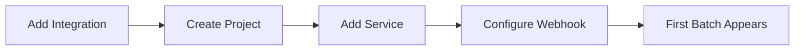

# Connect Your First Provider

This guide walks you through connecting an SCM provider, creating a project, adding a service, and verifying that data flows into SerOps.

---

## Overview

The end-to-end flow for getting data into SerOps is:

---

## Step 1: Add an Integration

Integrations store your SCM credentials once and let you reuse them across all projects.

1. Navigate to **Integrations**
2. Click **Add Integration**
3. Select your provider type:

    | Provider | Credential Type | Required Scope |
    |----------|----------------|----------------|
    | **GitLab** | Personal Access Token | `api` |
    | **GitHub** | Personal Access Token | `repo`, `read:org` |
    | **Azure DevOps** | Personal Access Token | `Code (Read)`, `Build (Read)` |
    | **Bitbucket** | App Password | `repository:read`, `pipeline:read` |

4. Enter a descriptive **Name** (e.g., "Company GitLab")
5. Paste your access token
6. Click **Save**

!!! tip
    Use a dedicated service account for the access token rather than a personal account. This avoids token invalidation when team members leave.

---

## Step 2: Create a Project

1. Navigate to **Projects**
2. Click **+ New Project**
3. Enter a **Project Name** (e.g., "Payment Service")
4. Configure **Environments** -- toggle on the environments you use (development, staging, production) and set branch patterns:

    | Environment | Example Pattern |
    |-------------|-----------------|
    | Production | `main, master, release/*` |
    | Staging | `staging, release-candidate/*` |
    | Development | `develop, dev, feature/*` |

5. Click **Create**

---

## Step 3: Add a Service Using the Integration

1. Open your newly created project
2. Click **+ Add Service**
3. Toggle **"Use Global Integration"** ON
4. Select your saved integration from the dropdown
5. Enter the **Project ID** (GitLab) or **Repository** (GitHub, e.g., `owner/repo-name`)
6. Click **Verify** to test the connection

    !!! success "Verification Success"
        If verification succeeds, you will see a green checkmark and the repository name.

    !!! failure "Verification Fails"
        - Confirm the access token has the required scopes
        - Confirm the Project ID or repository name is correct
        - Check that the token has not expired

7. Click **Add Service**

---

## Step 4: Configure the Webhook

Webhooks provide real-time updates when code is pushed or pipelines complete.

Each CI/CD binding gets its own unique webhook URL and auto-generated secret. You can either use **automatic setup** or configure manually.

### Automatic Setup (Recommended)

1. Navigate to your service's CI/CD binding
2. Click **Setup Webhook** (or call `POST /api/projects/cicd-bindings/{id}/setup-webhook/`)
3. SerOps registers the webhook URL and secret with the provider automatically (GitLab, GitHub, Bitbucket)

> **Note**: Jenkins and Azure DevOps require manual configuration — the setup action returns the URL and token for you to configure manually.

### GitLab (Manual)

1. In SerOps, navigate to your service's CI/CD binding and copy the **Webhook URL** and **Secret Token**
   - URL format: `https://your-serops.com/api/webhooks/gitlab/{binding_id}/`
2. In GitLab, go to your project's **Settings > Webhooks**
3. Paste the URL and Secret Token
4. Enable the following triggers:
    - [x] Push events
    - [x] Pipeline events
    - [x] Job events
5. Click **Add webhook**

### GitHub (Manual)

1. In SerOps, navigate to your service's CI/CD binding and copy the **Webhook URL** and **Secret**
   - URL format: `https://your-serops.com/api/webhooks/github/{binding_id}/`
2. In GitHub, go to your repository's **Settings > Webhooks > Add webhook**
3. Set **Payload URL** to the binding-specific webhook URL
4. Set **Content type** to `application/json`
5. Set **Secret** to the auto-generated secret
6. Select events:
    - [x] Pushes
    - [x] Workflow runs
7. Click **Add webhook**

!!! info "Automatic Background Sync"
    Even without webhooks, SerOps automatically syncs recent deployments every 10 minutes using your access token. Webhooks provide faster, real-time updates but are not strictly required.

---

## Step 5: Configure Your Data Collection Agents

Before batches can appear, your log shippers and metric exporters must tag every record with the correct enrichment fields (organisation, project, service, environment). SerOps uses these fields to query and filter data from your providers.

See **[Configure Data Collection Agents](configure-data-collection.md)** for the full field reference and agent configuration examples for Fluentd, Filebeat, Logstash, Promtail, Datadog Agent, and more.

---

## Step 6: Verify Your First Batch

Once data starts flowing:

1. Navigate to the **Analyses** page
2. You should see your first batch appear within the configured `BATCH_GENERATION_INTERVAL` (default: 60 seconds)
3. The batch will show:
    - Environment badge (Production, Staging, or Development)
    - Number of log entries included
    - AI analysis status (pending, analyzing, or complete)

!!! note
    The first batch may take a few minutes to appear, depending on:

    - Whether logs exist in your log storage provider for the registered service
    - The batch generation interval
    - Whether any deployments or code changes have been detected

---

## Troubleshooting

| Symptom | Likely Cause | Resolution |
|---------|-------------|------------|
| No batches appear | Service name mismatch | Ensure the `service_name` in your logs matches the registered service name exactly |
| No deployments shown | Token scope insufficient | Verify the access token has `api` scope (GitLab) or `repo` scope (GitHub) |
| Webhook not firing | URL unreachable | Ensure your SerOps instance is accessible from the SCM provider's network |
| "Unknown" status | Database naming | Check the [Troubleshooting](../troubleshooting.md) page for database table name issues |

---

## Next Steps

- [Configure Data Collection Agents](configure-data-collection.md) -- set up log shippers and metric exporters with the required enrichment fields
- [Set Up Infrastructure Services](infrastructure-services.md) -- add databases, caches, and other infrastructure
- [Compare AI Models](compare-ai-models.md) -- analyze batches with different AI models
- [Configure Quiet Hours](quiet-hours.md) -- suppress notifications during off-hours
