# Set Up Escalation Rules

Ensure critical issues are never missed by configuring automatic escalation chains that notify progressively senior team members when issues go unacknowledged.

---

## How Escalation Works

SerOps uses a two-level escalation hierarchy based on role:

```mermaid
graph TD
    I[Critical Issue Created] -->|Wait Level 1 delay| L1{Acknowledged?}
    L1 -->|Yes| S[Escalation Stopped]
    L1 -->|No| N1[Level 1: Notify project admins]
    N1 -->|Wait Level 2 delay| L2{Acknowledged?}
    L2 -->|Yes| S
    L2 -->|No| N2[Level 2: Notify ALL org admins]
```



| Level | Default Delay | Who Gets Notified | Purpose |
|-------|--------------|-------------------|---------|
| **Level 1** | 15 minutes | Project admins (users with `admin` role) | First responders |
| **Level 2** | 45 minutes | All organisation admins | Final escalation for unresolved issues |

**Key behaviors:**

- Escalation timers start when the issue is **created**
- **Acknowledging** the issue at any point stops the escalation chain
- Rules can target specific projects or apply to **all projects** in the organisation
- Rules can be set for `CRITICAL` or `WARNING` severity levels

---

## Create an Escalation Rule via the UI

1. Navigate to **Settings > Routing Rules > Escalation Rules**
2. Click **+ Add Rule**
3. Configure the rule:

    | Field | Required | Description |
    |-------|----------|-------------|
    | **Project** | No | Specific project, or leave blank for all projects |
    | **Severity** | Yes | `CRITICAL` or `WARNING` |
    | **Level 1 Delay** | Yes | Minutes before notifying project admins (default: 15) |
    | **Level 2 Delay** | Yes | Minutes before notifying all org admins (default: 45) |
    | **Active** | Yes | Whether this rule is currently enabled |

4. Click **Save**

!!! warning
    Level 2 delay must be greater than Level 1 delay. The system validates this and will reject invalid configurations.

---

## Create an Escalation Rule via the API

### Create a Rule

```bash
curl -X POST https://api.yourdomain.com/api/notification/escalation-rules/ \
  -H "Authorization: Bearer YOUR_TOKEN" \
  -H "Content-Type: application/json" \
  -d '{
    "project": 1,
    "severity": "CRITICAL",
    "level_1_delay_minutes": 15,
    "level_2_delay_minutes": 45,
    "is_active": true
  }'
```

Response:

```json
{
  "id": 1,
  "project": 1,
  "project_name": "Payment Service",
  "severity": "CRITICAL",
  "level_1_delay_minutes": 15,
  "level_2_delay_minutes": 45,
  "is_active": true,
  "created_at": "2026-02-17T10:00:00Z",
  "updated_at": "2026-02-17T10:00:00Z"
}
```

### Create an Organisation-Wide Rule

Omit the `project` field to apply the rule to all projects:

```bash
curl -X POST https://api.yourdomain.com/api/notification/escalation-rules/ \
  -H "Authorization: Bearer YOUR_TOKEN" \
  -H "Content-Type: application/json" \
  -d '{
    "severity": "CRITICAL",
    "level_1_delay_minutes": 10,
    "level_2_delay_minutes": 30,
    "is_active": true
  }'
```

### List All Rules

```bash
curl https://api.yourdomain.com/api/notification/escalation-rules/ \
  -H "Authorization: Bearer YOUR_TOKEN"
```

### Update a Rule

```bash
curl -X PUT https://api.yourdomain.com/api/notification/escalation-rules/1/ \
  -H "Authorization: Bearer YOUR_TOKEN" \
  -H "Content-Type: application/json" \
  -d '{
    "level_1_delay_minutes": 10,
    "level_2_delay_minutes": 30
  }'
```

### Delete a Rule

```bash
curl -X DELETE https://api.yourdomain.com/api/notification/escalation-rules/1/ \
  -H "Authorization: Bearer YOUR_TOKEN"
```

---

## Stopping Escalation with Acknowledgment

Any user can acknowledge an issue to stop its escalation chain:

=== "UI"

    1. Open the issue from the **Issues** page or from the notification
    2. Click the **Acknowledge** button
    3. The escalation timer stops immediately

=== "API"

    ```bash
    curl -X POST https://api.yourdomain.com/api/data/issues/{issue_id}/acknowledge/ \
      -H "Authorization: Bearer YOUR_TOKEN"
    ```

!!! info
    Acknowledgment means "someone is looking at this." It does not resolve the issue -- it just stops the escalation from notifying additional people.

---

## Recommended Configurations

### Aggressive (SRE / On-Call Teams)

For teams that require rapid incident response:

| Setting | Value |
|---------|-------|
| Severity | `CRITICAL` |
| Level 1 Delay | 5 minutes |
| Level 2 Delay | 15 minutes |
| Scope | All projects |

### Standard (Development Teams)

For typical development workflows:

| Setting | Value |
|---------|-------|
| Severity | `CRITICAL` |
| Level 1 Delay | 15 minutes |
| Level 2 Delay | 45 minutes |
| Scope | Per project |

### Relaxed (Non-Critical Services)

For staging or low-priority environments:

| Setting | Value |
|---------|-------|
| Severity | `CRITICAL` |
| Level 1 Delay | 60 minutes |
| Level 2 Delay | 180 minutes |
| Scope | Specific project |

---

## Uniqueness Constraint

Each combination of organisation + project + severity must be unique. You cannot create two `CRITICAL` escalation rules for the same project. To change timing, update the existing rule.

If you attempt to create a duplicate rule, the API returns:

```json
{
  "detail": "Escalation rule for this project and severity already exists."
}
```

---

## Combining with Quiet Hours

Escalation rules and [quiet hours](quiet-hours.md) interact as follows:

- If a user's quiet hours are **active**, Level 1 and Level 2 notifications to that specific user are **suppressed** and queued
- However, escalation still proceeds to the **next level** on schedule -- other admins whose quiet hours are not active will receive the notification
- This ensures critical issues reach someone even when individual team members are unavailable

---

## Next Steps

- [Configure Quiet Hours](quiet-hours.md) -- set up per-user quiet hours
- [Tune Issue Deduplication](tune-deduplication.md) -- reduce noise before it reaches escalation
- [Notifications](../user-guide/notifications.md) -- full notification system overview
