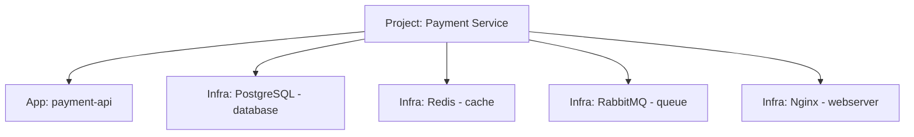

# Set Up Infrastructure Services

Register your infrastructure components (databases, caches, message queues, etc.) as services in SerOps to monitor their health and include them in batch analysis.

---

## Overview

Infrastructure Services represent the non-application components your system depends on. Unlike application services that are linked to SCM repositories, infrastructure services connect directly to your infrastructure providers for health monitoring.

---

## Infrastructure Types

SerOps supports the following infrastructure service types:

| Type | Key | Description | Example |
|------|-----|-------------|---------|
| **Database** | `database` | Relational or document databases | PostgreSQL, MySQL, MongoDB |
| **Cache** | `cache` | In-memory data stores | Redis, Memcached |
| **Message Queue** | `queue` | Message brokers and event streaming | RabbitMQ, Kafka |
| **Object Storage** | `storage` | File and object storage | AWS S3, MinIO |
| **Container Registry** | `container` | Container image registries | Docker Hub, GitLab Registry |
| **Kubernetes** | `kubernetes` | Container orchestration clusters | K8s, EKS, GKE |
| **CDN** | `cdn` | Content delivery networks | CloudFront, Cloudflare |
| **Web Server** | `webserver` | Web servers and reverse proxies | Nginx, Apache |

---

## Available Providers

Each infrastructure type can be backed by a specific provider:

| Provider Key | Provider Name | Common Use |
|-------------|---------------|------------|
| `postgresql` | PostgreSQL | Database |
| `mysql` | MySQL | Database |
| `mongodb` | MongoDB | Database |
| `redis` | Redis | Cache |
| `elasticsearch` | Elasticsearch | Database / Search |
| `rabbitmq` | RabbitMQ | Message Queue |
| `kafka` | Kafka | Message Queue |
| `s3` | AWS S3 | Object Storage |
| `docker` | Docker | Container Registry |
| `k8s` | Kubernetes | Kubernetes |
| `nginx` | Nginx | Web Server |
| `apache` | Apache | Web Server |

---

## Adding an Infrastructure Service via the UI

1. Navigate to **Projects > [Your Project] > Services**
2. Click **+ Add Service**
3. Select **Infrastructure** as the service type
4. Fill in the form:

    | Field | Required | Description |
    |-------|----------|-------------|
    | **Name** | Yes | Display name (e.g., "Production PostgreSQL") |
    | **Infrastructure Type** | Yes | Select from the dropdown (database, cache, queue, etc.) |
    | **Provider** | No | Specific technology (e.g., PostgreSQL, Redis) |
    | **Host** | No | Hostname or IP address |
    | **Port** | No | Port number |
    | **Connection String** | No | Full connection URI (stored encrypted, write-only) |
    | **Health Check URL** | No | URL for automated health monitoring |
    | **Description** | No | Role and connections (max 500 chars). Passed to AI for better issue detection. |

5. Click **Save**

!!! warning "Connection Strings"
    Connection strings are stored encrypted and are write-only -- they cannot be viewed after saving. If you need to update a connection string, enter the new value and save again.

---

## Adding an Infrastructure Service via API

```bash
curl -X POST https://api.yourdomain.com/api/services/infra/ \
  -H "Authorization: Bearer YOUR_TOKEN" \
  -H "Content-Type: application/json" \
  -d '{
    "project": 1,
    "name": "Production PostgreSQL",
    "infra_type": "database",
    "provider": "postgresql",
    "host": "postgres.internal",
    "port": 5432,
    "health_check_url": "http://postgres.internal:5432",
    "description": "Primary production database"
  }'
```

Response:

```json
{
  "id": 12,
  "project": 1,
  "name": "Production PostgreSQL",
  "category": "infrastructure",
  "status": "active",
  "infra_type": "database",
  "provider": "postgresql",
  "host": "postgres.internal",
  "port": 5432,
  "health_check_url": "http://postgres.internal:5432",
  "health_status": "unknown",
  "last_health_check": null,
  "created_at": "2026-02-17T10:00:00Z",
  "updated_at": "2026-02-17T10:00:00Z"
}
```

---

## Running Health Checks

Trigger a health check on any infrastructure service:

=== "UI"

    1. Navigate to **Projects > [Your Project] > Services**
    2. Find the infrastructure service card
    3. Click the **Health Check** button

=== "API"

    ```bash
    curl -X POST https://api.yourdomain.com/api/services/infra/12/health_check/ \
      -H "Authorization: Bearer YOUR_TOKEN"
    ```

    Response:

    ```json
    {
      "status": "healthy",
      "checked_at": "2026-02-17T10:05:00Z"
    }
    ```

### Health Status Values

| Status | Meaning |
|--------|---------|
| `healthy` | Service is reachable and responding normally |
| `unhealthy` | Service is unreachable or returning errors |
| `unknown` | No health check has been performed yet |

---

## Example: Full Stack Setup

A typical project might register the following infrastructure services:



This gives you a complete view of your service's dependencies in the project dashboard.

---

## Next Steps

- [Connect Your First Provider](connect-provider.md) -- add application services with SCM integration
- [Compare AI Models](compare-ai-models.md) -- analyze infrastructure logs with AI
