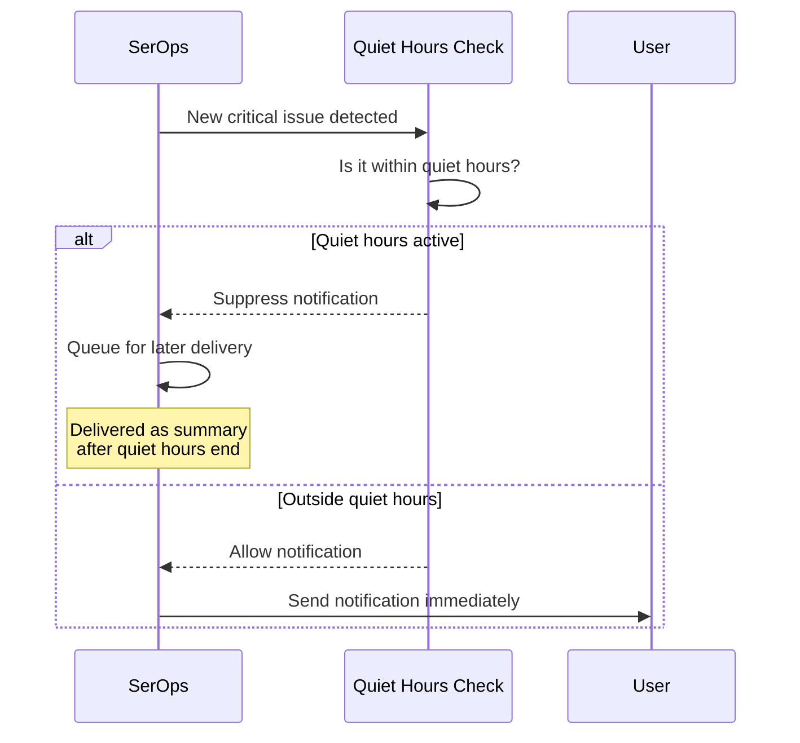

# Configure Quiet Hours

Suppress notifications during off-hours so your team is not disturbed by non-urgent alerts. Notifications that arrive during quiet hours are held and delivered as a summary when the quiet period ends.

---

## How Quiet Hours Work



Key behaviors:

- Notifications are **suppressed**, not discarded -- they are queued and delivered as a digest summary after quiet hours end
- Quiet hours are calculated in the user's **configured timezone**
- Overnight windows (e.g., 22:00 to 08:00) are supported
- Each user configures their own quiet hours independently

---

## Configure via the UI

1. Click your **profile avatar** in the top-right corner
2. Navigate to **Notification Preferences**
3. In the **Quiet Hours** section:

    | Setting | Description |
    |---------|-------------|
    | **Enable Quiet Hours** | Toggle on to activate |
    | **Start Time** | When quiet hours begin (e.g., `22:00`) |
    | **End Time** | When quiet hours end (e.g., `08:00`) |
    | **Timezone** | Your local timezone (e.g., `America/New_York`) |

4. Click **Save**

!!! tip
    Set your timezone correctly to ensure quiet hours align with your actual schedule. The system converts all times to your configured timezone before checking.

---

## Configure via the API

Update your notification preferences using the API:

```bash
curl -X PATCH https://api.yourdomain.com/api/notification/preferences/ \
  -H "Authorization: Bearer YOUR_TOKEN" \
  -H "Content-Type: application/json" \
  -d '{
    "quiet_hours_enabled": true,
    "quiet_hours_start": "22:00",
    "quiet_hours_end": "08:00",
    "timezone": "America/New_York"
  }'
```

Response:

```json
{
  "id": 1,
  "email_enabled": true,
  "in_app_enabled": true,
  "notify_critical": true,
  "notify_warning": true,
  "notify_info": false,
  "digest_frequency": "immediate",
  "quiet_hours_enabled": true,
  "quiet_hours_start": "22:00:00",
  "quiet_hours_end": "08:00:00",
  "timezone": "America/New_York",
  "created_at": "2026-01-15T10:00:00Z",
  "updated_at": "2026-02-17T14:30:00Z"
}
```

### Retrieve Current Preferences

```bash
curl https://api.yourdomain.com/api/notification/preferences/ \
  -H "Authorization: Bearer YOUR_TOKEN"
```

---

## Preference Fields Reference

| Field | Type | Default | Description |
|-------|------|---------|-------------|
| `quiet_hours_enabled` | boolean | `false` | Whether quiet hours are active |
| `quiet_hours_start` | time | `null` | Start of quiet period (HH:MM format) |
| `quiet_hours_end` | time | `null` | End of quiet period (HH:MM format) |
| `timezone` | string | `UTC` | IANA timezone name for time calculations |

### Supported Timezone Examples

| Timezone | UTC Offset |
|----------|------------|
| `UTC` | +00:00 |
| `America/New_York` | -05:00 |
| `America/Chicago` | -06:00 |
| `America/Los_Angeles` | -08:00 |
| `Europe/London` | +00:00 |
| `Europe/Paris` | +01:00 |
| `Asia/Tokyo` | +09:00 |
| `Australia/Sydney` | +11:00 |

!!! info
    Any valid [IANA timezone name](https://en.wikipedia.org/wiki/List_of_tz_database_time_zones) is accepted.

---

## Examples

### Standard Overnight Quiet Hours

Suppress notifications from 10 PM to 8 AM:

```json
{
  "quiet_hours_enabled": true,
  "quiet_hours_start": "22:00",
  "quiet_hours_end": "08:00",
  "timezone": "America/New_York"
}
```

### Weekend-Style Extended Hours

Suppress notifications from 6 PM Friday to 9 AM (for daily use, set the window to cover evenings):

```json
{
  "quiet_hours_enabled": true,
  "quiet_hours_start": "18:00",
  "quiet_hours_end": "09:00",
  "timezone": "Europe/London"
}
```

### Disable Quiet Hours

```json
{
  "quiet_hours_enabled": false
}
```

---

## Combining with Other Notification Settings

Quiet hours work alongside other notification preferences:

| Setting | Effect |
|---------|--------|
| **Severity filters** (`notify_critical`, `notify_warning`, `notify_info`) | Filters which notifications are created at all |
| **Quiet hours** | Delays delivery of notifications that pass severity filters |
| **Digest frequency** (`immediate`, `hourly`, `daily`, `weekly`) | Controls how non-quiet-hours notifications are batched |
| **Channel toggles** (`email_enabled`, `in_app_enabled`) | Controls which channels receive notifications |

The evaluation order is: severity filter > channel check > quiet hours check > digest scheduling.

---

## Next Steps

- [Set Up Escalation Rules](escalation-rules.md) -- ensure critical issues still reach someone
- [Notifications Overview](../user-guide/notifications.md) -- full notification system documentation
