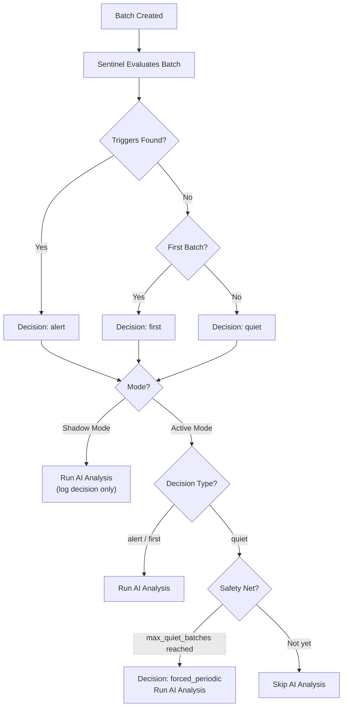

# Configure Sentinel Tiered Intelligence

Sentinel is an intelligent gating layer that evaluates every batch before AI analysis to decide whether full AI processing is needed. By detecting "quiet" batches -- those with no anomalies, deployments, or new error patterns -- Sentinel skips unnecessary AI calls, saving 80--90% of your AI API usage while ensuring that every meaningful event still receives full analysis.

---

## How Sentinel Works

When a batch is created, Sentinel evaluates it against rolling baselines for the corresponding project and environment. Based on what it finds, it assigns a decision that determines whether AI analysis runs.



Key behaviours:

- **Shadow mode** (default): Sentinel evaluates every batch and records its decision, but AI analysis always runs regardless. This lets you observe Sentinel's accuracy before trusting it.
- **Active mode**: Sentinel gates AI analysis. Quiet batches skip AI entirely, saving tokens and cost. Alert and first batches still receive full analysis.
- **Safety net**: Even in active mode, Sentinel forces AI analysis after a configurable number of consecutive quiet batches (`max_quiet_batches`) to prevent blind spots.

---

## Decision Types

Every batch receives one of four Sentinel decisions:

| Decision | Meaning | AI Runs? (Active Mode) |
|----------|---------|----------------------|
| **alert** | One or more triggers detected (error spike, deployment, new pattern, etc.) | Yes |
| **quiet** | No triggers found; environment is stable | No (skipped) |
| **first** | First batch ever seen for this project + environment combination (no baseline exists) | Yes |
| **shadow** | Sentinel was in shadow mode when this batch was evaluated | Yes (always) |

!!! info
    In shadow mode, all batches are recorded with the decision `shadow`. The underlying evaluation still happens internally, but the decision field shows `shadow` to indicate that gating was not active.

---

## Trigger Types

Sentinel evaluates eight trigger types on every batch. If any trigger fires, the batch is classified as `alert`.

| Trigger | Description | Default Threshold |
|---------|-------------|-------------------|
| `deployment_detected` | A new deployment occurred within the batch time window | -- |
| `new_error_pattern` | An error fingerprint appeared that was not seen in the last 50 batches | -- |
| `error_rate_spike` | Error rate exceeds the rolling baseline multiplied by the spike multiplier | 2.0x baseline |
| `memory_anomaly` | Memory usage z-score above the configured threshold | z-score > 3.0 |
| `cpu_anomaly` | CPU usage z-score above the configured threshold | z-score > 3.0 |
| `error_rate_escalating` | Error rate is trending upward across recent batches | -- |
| `issue_regression` | A previously resolved issue's fingerprint reappeared in this batch | -- |
| `forced_periodic` | Safety net: forced AI analysis after `max_quiet_batches` consecutive quiet batches | 12 batches |

When a batch triggers, the specific trigger names are stored in the `sentinel_triggers` field on the batch record. A single batch can have multiple triggers.

!!! note
    The `forced_periodic` trigger is a safety mechanism. It ensures that even a genuinely stable service is periodically analyzed by AI, preventing situations where a slow-building issue goes unnoticed. Batches triggered only by `forced_periodic` display an amber **ROUTINE** badge instead of the red **ALERT** badge, making it easy to distinguish routine checks from real alerts.

---

## Shadow Mode vs Active Mode

### Shadow Mode (Default)

Shadow mode is the default when Sentinel is first enabled. In this mode:

- Every batch is evaluated by Sentinel
- The decision is logged for observability
- AI analysis **always runs** regardless of the decision
- Batches appear with a grey **shadow** badge in the batch list

Use shadow mode to build confidence that Sentinel's decisions are correct before switching to active gating.

### Active Mode

In active mode, Sentinel gates AI analysis:

- Batches with an `alert` or `first` decision run AI analysis as normal
- Batches with a `quiet` decision **skip AI analysis entirely**
- The `forced_periodic` safety net triggers after `max_quiet_batches` consecutive quiet batches
- Skipped batches are still created and visible in the batch list, but have no AI-generated summary

!!! warning
    Switching to active mode immediately starts skipping AI for quiet batches. Make sure you have run in shadow mode long enough to trust the decisions before enabling active mode.

---

## Configuration

Navigate to **Settings > Sentinel** to configure Sentinel Intelligence.

### Settings Reference

| Setting | Default | Description |
|---------|---------|-------------|
| **Enable Active Mode** | Off (shadow) | Toggle between shadow mode and active gating mode |
| **Error Spike Multiplier** | 2.0 | How many times above the rolling baseline error rate triggers an `error_rate_spike`. Set to 0 to use the system default. |
| **Z-Score Threshold** | 3.0 | Number of standard deviations from the mean for `memory_anomaly` and `cpu_anomaly` detection. Set to 0 to use the system default. |
| **Max Quiet Batches** | 12 | Maximum consecutive quiet batches before `forced_periodic` triggers AI analysis |

### Configure via the API

**Retrieve current configuration:**

```bash
curl https://api.yourdomain.com/api/settings/sentinel/ \
  -H "Authorization: Token YOUR_TOKEN"
```

Response:

```json
{
  "active_mode": false,
  "error_spike_multiplier": 0,
  "z_score_threshold": 0,
  "max_quiet_batches": 12
}
```

**Update configuration:**

```bash
curl -X PUT https://api.yourdomain.com/api/settings/sentinel/ \
  -H "Authorization: Token YOUR_TOKEN" \
  -H "Content-Type: application/json" \
  -d '{
    "active_mode": true,
    "error_spike_multiplier": 1.5,
    "z_score_threshold": 3.0,
    "max_quiet_batches": 10
  }'
```

!!! info
    Sentinel configuration requires admin permissions. The API uses `Token` authentication consistent with the rest of the SerOps API.

---

## Viewing Sentinel Decisions

### Batch List

The **Data** page displays a **Sentinel** column in the batch table. Each batch shows a coloured badge:

| Badge | Colour | Meaning |
|-------|--------|---------|
| **ALERT** | Red (`#fee2e2` / `#991b1b`) | Real triggers detected (deployment, error spike, anomaly, etc.) |
| **ROUTINE** | Amber (`--warning-100` / `--warning-600`) | Periodic health check — no triggers, forced by safety net |
| **QUIET** | Green (`#d1fae5` / `#065f46`) | No triggers, stable environment |
| **FIRST** | Blue (`#dbeafe` / `#1e40af`) | First batch for this project + environment |
| **SHADOW** | Grey (`#f3f4f6` / `#6b7280`) | Evaluated in shadow mode |

### Dashboard

The **Dashboard** includes a **Sentinel Intelligence** card that provides an at-a-glance summary:

- **Skip rate percentage** -- the proportion of batches where AI analysis was saved
- **Decision breakdown** -- counts of alert, quiet, and first decisions over the selected period
- **Savings summary** -- number of AI calls skipped and estimated tokens saved

The card refreshes every two minutes and defaults to a 7-day lookback window.

---

## Rolling Baselines

Sentinel learns what "normal" looks like for each project and environment by maintaining rolling baselines in a `ProjectEnvironmentState` record.

### What is Tracked

| Baseline | Method | Description |
|----------|--------|-------------|
| **Error rate** | Exponential moving average (EMA) | Smoothed error rate across recent batches |
| **Memory usage** | Rolling mean + standard deviation | Average and variance of memory metrics |
| **CPU usage** | Rolling mean + standard deviation | Average and variance of CPU metrics |
| **Known error fingerprints** | Last 50 batches | Set of error fingerprints seen recently, used to detect `new_error_pattern` |
| **Deployment state** | Last deploy SHA + timestamp | Tracks the most recent deployment to detect new ones |
| **AI analysis cadence** | Batches since last AI run | Counter used by `forced_periodic` safety net |

### How Baselines Update

Baselines update **with every batch evaluation**, not just when AI runs. This means:

1. A new batch arrives for project "api-gateway" in the "production" environment
2. Sentinel loads the `ProjectEnvironmentState` for that combination
3. The batch's metrics (error count, memory, CPU) are compared against the baselines
4. After evaluation, the baselines are updated with the new data points
5. The EMA and rolling statistics incorporate the latest batch

This ensures that baselines remain current even during long stretches of quiet batches in active mode.

!!! tip
    The first batch for any project + environment is always classified as `first` because no baseline exists yet. After that first evaluation, Sentinel has enough data to begin making alert/quiet decisions.

---

## Best Practices

!!! tip "Start with shadow mode"
    Run Sentinel in shadow mode for **1--2 weeks** before enabling active mode. Review the Sentinel Intelligence dashboard card to verify that alert decisions align with batches that actually contained issues, and quiet decisions align with uneventful batches.

!!! tip "Monitor the dashboard"
    Check the **Sentinel Intelligence** card on the Dashboard regularly after switching to active mode. A healthy skip rate is typically 70--90%. If the skip rate is unexpectedly low, your thresholds may be too sensitive. If it is unexpectedly high, thresholds may be too lenient.

!!! tip "Keep the safety net tight"
    The `max_quiet_batches` setting controls how long Sentinel can go without forcing an AI analysis. Keep this at **12 or lower** to ensure periodic AI oversight. For services that generate batches hourly, a value of 12 means at least one AI analysis every 12 hours.

!!! tip "Tune thresholds for critical services"
    For your most important services, consider lowering the `error_spike_multiplier` to **1.5** (from the default 2.0). This makes Sentinel more sensitive to error rate increases, reducing the chance of missing a developing incident on a critical path.

!!! warning "Do not set max_quiet_batches too high"
    Setting `max_quiet_batches` to a very high value (e.g., 100) effectively disables the safety net. If Sentinel misclassifies an important batch as quiet, there would be a long gap before the next forced analysis catches it.

---

## Next Steps

- [Track AI Costs](ai-costs.md) -- monitor token usage and cost savings from Sentinel
- [Compare AI Models](compare-ai-models.md) -- pair Sentinel with a cost-effective model for maximum savings
- [Dashboard Overview](../user-guide/dashboard.md) -- learn about all dashboard cards including Sentinel Intelligence
