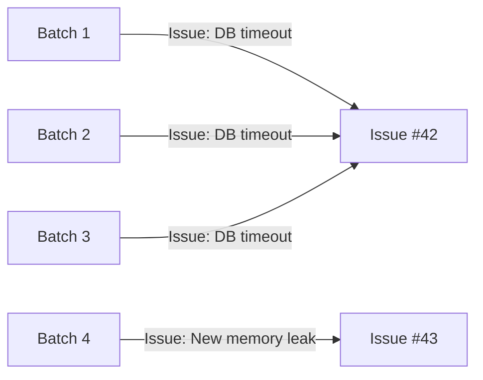

# Tune Issue Deduplication

Configure how SerOps groups similar issues to reduce noise and prevent duplicate alerts from cluttering your issue list.

---

## What Is Deduplication?

When SerOps analyzes a batch, it may detect issues that are identical or very similar to issues found in previous batches. Deduplication prevents these from creating separate issue records by matching new issues against existing ones using a **fingerprint** -- a hash derived from the issue's key characteristics (error type, message pattern, affected service).



Without deduplication, each batch would create a new issue, leading to hundreds of duplicates for recurring problems. With deduplication, recurring issues are grouped under a single issue record with an updated occurrence count.

---

### An incident that changes as it evolves

An incident rarely keeps one type: a memory leak becomes crashing pods, then a
rollback and recovery. Each step has its own fingerprint, so on its own it would
open a new issue. When a step matches no fingerprint, an issue that is still open
on the same project, environment and component, and was seen in the last two
hours, takes it instead: its type, severity and text follow the incident, and the
issue keeps the type each analysis saw in its history. Two findings from the same
analysis are never merged into one issue, so two causes on one component at the
same time stay two issues. The horizon is `SEROPS_ISSUE_CONTINUITY_HOURS`
([configuration](../deployment/configuration.md)); `0` turns this off.

## Configuration Settings

Navigate to **Settings > Data retention** to configure deduplication for your organisation.

### Settings Reference

| Setting | Default | Options | Description |
|---------|---------|---------|-------------|
| **Deduplication Enabled** | `true` | `true` / `false` | When enabled, issues with matching fingerprints are grouped instead of duplicated |
| **Dedup Window** | `7 days` | 7, 14, 30, 90 days, or Forever | How far back to look for matching issues. Issues older than this window are treated as new. |
| **Default Mute Duration** | `7 days` | 1 day, 1 week, 30 days, or Forever | Stored, but not used in 1.5.5: the mute dialog always pre-selects 7 days, and a mute lasts until someone reopens the issue |
| **Auto-Resolve Enabled** | `false` | `true` / `false` | Stored, not applied: SerOps does not resolve issues automatically in 1.5.5 |
| **Auto-Resolve After** | `7 days` | Any positive integer (API only) | Stored, not applied |

---

## Choosing the Right Dedup Window

The dedup window controls how long SerOps remembers an issue fingerprint when checking for duplicates.

| Window | Best For | Trade-off |
|--------|----------|-----------|
| **7 days** | Fast-moving teams with frequent deployments | May re-create issues for intermittent problems |
| **14 days** | Standard development cycles | Good balance for most teams |
| **30 days** | Monthly release cadences | Catches longer-lived recurring issues |
| **90 days** | Quarterly releases or seasonal patterns | May group unrelated issues that share a fingerprint |
| **Forever** | Maximum deduplication | Issues are never treated as new if the fingerprint matches |

!!! tip
    Start with the default of **7 days** and increase if you see the same issue being re-created after each sprint or deployment cycle.

---

## Configure via the UI

1. Navigate to **Settings > Data retention**
2. Adjust the settings:
    - Toggle **Deduplication Enabled** on or off
    - Select the **Dedup Window** from the dropdown
    - Set the **Default Mute Duration**
    - Toggle **Auto-Resolve** (stored, not applied in 1.5.5)
3. Click **Save**

---

## Configure via the API

### Get Current Settings

```bash
curl https://api.yourdomain.com/api/settings/issues/ \
  -H "Authorization: Token YOUR_TOKEN"
```

Response:

```json
{
  "id": 1,
  "dedup_enabled": true,
  "dedup_window_days": 7,
  "default_mute_duration_days": 7,
  "auto_resolve_enabled": false,
  "auto_resolve_after_days": 7,
  "updated_at": "2026-02-17T10:00:00Z"
}
```

### Update Settings

```bash
curl -X PUT https://api.yourdomain.com/api/settings/issues/ \
  -H "Authorization: Token YOUR_TOKEN" \
  -H "Content-Type: application/json" \
  -d '{
    "dedup_enabled": true,
    "dedup_window_days": 14,
    "default_mute_duration_days": 7,
    "auto_resolve_enabled": true,
    "auto_resolve_after_days": 14
  }'
```

!!! note
    Only organisation admins can modify issue settings. Users with the `user` or `viewer` role will receive a `403 Forbidden` response.

---

## Muting vs. Deduplication

These are complementary features:

| Feature | Purpose | Effect |
|---------|---------|--------|
| **Deduplication** | Prevent duplicate issue records | New occurrences increment the count on the existing issue |
| **Muting** | Silence notifications for a known issue | The issue still exists and tracks occurrences, but no alerts are sent |

Use muting for issues you are aware of but cannot fix immediately. Use deduplication tuning to control how aggressively SerOps groups similar issues.

---

## Next Steps

- [Issues](../user-guide/issues.md) -- managing and triaging issues
- [Set Up Escalation Rules](escalation-rules.md) -- escalate unacknowledged issues
- [Configure Quiet Hours](quiet-hours.md) -- suppress notifications during off-hours
