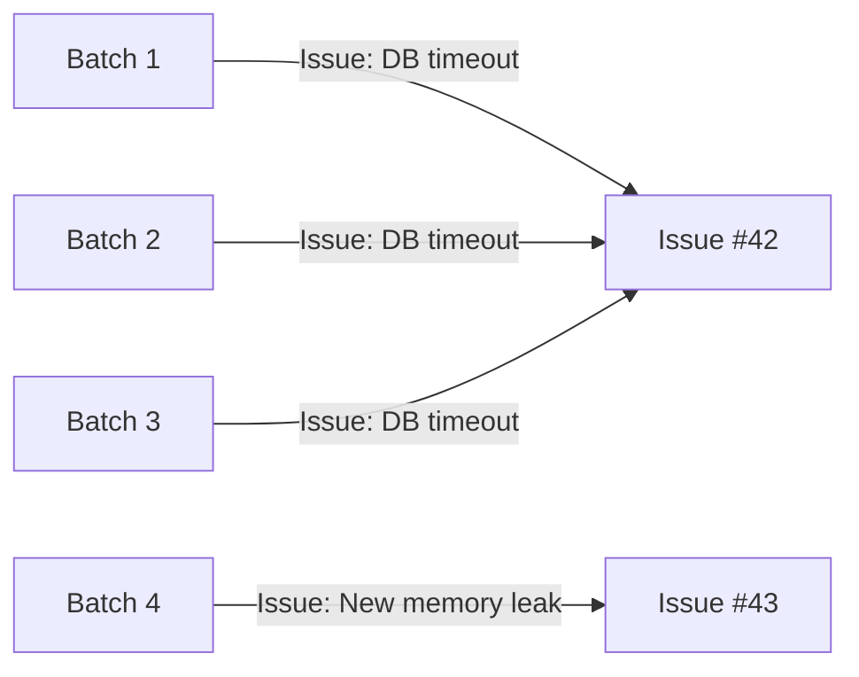
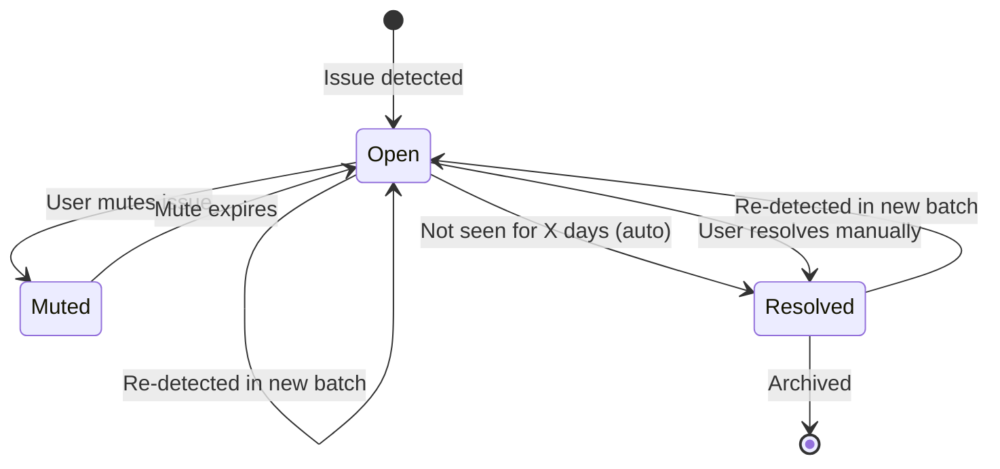

# Tune Issue Deduplication

Configure how SerOps groups similar issues to reduce noise and prevent duplicate alerts from cluttering your issue list.

---

## What Is Deduplication?

When SerOps analyzes a batch, it may detect issues that are identical or very similar to issues found in previous batches. Deduplication prevents these from creating separate issue records by matching new issues against existing ones using a **fingerprint** -- a hash derived from the issue's key characteristics (error type, message pattern, affected service).



Without deduplication, each batch would create a new issue, leading to hundreds of duplicates for recurring problems. With deduplication, recurring issues are grouped under a single issue record with an updated occurrence count.

---

## Configuration Settings

Navigate to **Settings > Data Management** to configure deduplication for your organisation.

### Settings Reference

| Setting | Default | Options | Description |
|---------|---------|---------|-------------|
| **Deduplication Enabled** | `true` | `true` / `false` | When enabled, issues with matching fingerprints are grouped instead of duplicated |
| **Dedup Window** | `7 days` | 7, 14, 30, 90 days, or Forever | How far back to look for matching issues. Issues older than this window are treated as new. |
| **Default Mute Duration** | `7 days` | 1 day, 1 week, 30 days, or Forever | Default duration when a user mutes an issue from the UI |
| **Auto-Resolve Enabled** | `false` | `true` / `false` | Automatically resolve issues that have not been detected for a configurable number of days |
| **Auto-Resolve After** | `7 days` | Any positive integer | Number of days without detection before an issue is auto-resolved |

---

## Choosing the Right Dedup Window

The dedup window controls how long SerOps remembers an issue fingerprint when checking for duplicates.

| Window | Best For | Trade-off |
|--------|----------|-----------|
| **7 days** | Fast-moving teams with frequent deployments | May re-create issues for intermittent problems |
| **14 days** | Standard development cycles | Good balance for most teams |
| **30 days** | Monthly release cadences | Catches longer-lived recurring issues |
| **90 days** | Quarterly releases or seasonal patterns | May group unrelated issues that share a fingerprint |
| **Forever** | Maximum deduplication | Issues are never treated as new if the fingerprint matches |

!!! tip
    Start with the default of **7 days** and increase if you see the same issue being re-created after each sprint or deployment cycle.

---

## Configure via the UI

1. Navigate to **Settings > Data Management**
2. Adjust the settings:
    - Toggle **Deduplication Enabled** on or off
    - Select the **Dedup Window** from the dropdown
    - Set the **Default Mute Duration**
    - Toggle **Auto-Resolve** and set the day threshold
3. Click **Save**

---

## Configure via the API

### Get Current Settings

```bash
curl https://api.yourdomain.com/api/settings/issue-settings/ \
  -H "Authorization: Bearer YOUR_TOKEN"
```

Response:

```json
{
  "id": 1,
  "dedup_enabled": true,
  "dedup_window_days": 7,
  "default_mute_duration_days": 7,
  "auto_resolve_enabled": false,
  "auto_resolve_after_days": 7,
  "updated_at": "2026-02-17T10:00:00Z"
}
```

### Update Settings

```bash
curl -X PUT https://api.yourdomain.com/api/settings/issue-settings/ \
  -H "Authorization: Bearer YOUR_TOKEN" \
  -H "Content-Type: application/json" \
  -d '{
    "dedup_enabled": true,
    "dedup_window_days": 14,
    "default_mute_duration_days": 7,
    "auto_resolve_enabled": true,
    "auto_resolve_after_days": 14
  }'
```

!!! note
    Only organisation admins can modify issue settings. Users with the `user` or `viewer` role will receive a `403 Forbidden` response.

---

## Auto-Resolve Workflow

When auto-resolve is enabled, the lifecycle of an issue looks like this:



!!! warning
    Auto-resolve only applies to issues that have not been detected in any batch for the configured number of days. If the underlying problem persists and keeps appearing in batches, the issue will remain open.

---

## Muting vs. Deduplication

These are complementary features:

| Feature | Purpose | Effect |
|---------|---------|--------|
| **Deduplication** | Prevent duplicate issue records | New occurrences increment the count on the existing issue |
| **Muting** | Silence notifications for a known issue | The issue still exists and tracks occurrences, but no alerts are sent |

Use muting for issues you are aware of but cannot fix immediately. Use deduplication tuning to control how aggressively SerOps groups similar issues.

---

## Next Steps

- [Issues](../user-guide/issues.md) -- managing and triaging issues
- [Set Up Escalation Rules](escalation-rules.md) -- escalate unacknowledged issues
- [Configure Quiet Hours](quiet-hours.md) -- suppress notifications during off-hours
