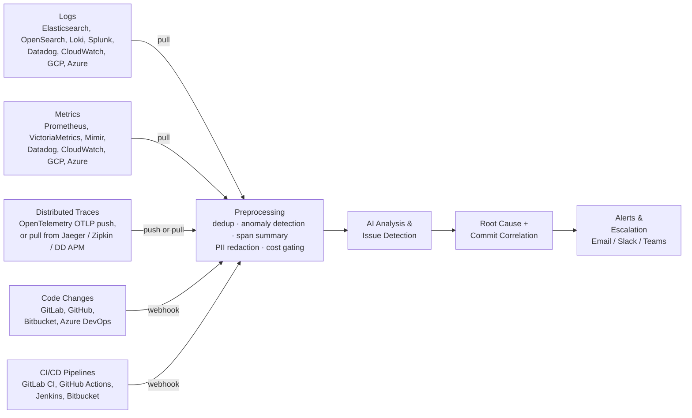

# Welcome to SerOps

**SerOps** is an AI-powered incident detection and resolution platform. It connects to your existing observability, SCM, and CI/CD tools — correlating logs, metrics, distributed traces, code changes, and deployments to automatically detect issues and explain their root cause.

-   :material-rocket-launch:{ .lg .middle } **Getting Started**

    ---

    Set up SerOps and create your first project in minutes.

    [:octicons-arrow-right-24: Quick Start](getting-started/quick-start-self-hosted.md)

-   :material-connection:{ .lg .middle } **Connect Your Stack**

    ---

    Bring your own observability, SCM, and CI/CD tools. SerOps integrates with Elasticsearch, Prometheus, Datadog, GitLab, GitHub, and more.

    [:octicons-arrow-right-24: Integrations](integrations/overview.md)

-   :material-robot:{ .lg .middle } **AI-Powered Correlation**

    ---

    Pluggable AI models analyze your logs alongside metrics, distributed traces, and code changes to pinpoint root causes and recommend fixes.

    [:octicons-arrow-right-24: AI Chat](user-guide/ai-chat.md)

-   :material-shield-check:{ .lg .middle } **Security First**

    ---

    All data is scanned for PII and credentials before AI analysis. SSO, RBAC, and full audit logging included.

    [:octicons-arrow-right-24: Data Protection](security/data-protection.md)

## How SerOps Works

SerOps sits on top of the tools you already use. It takes in five kinds of
signal, prepares them, and uses AI to connect the dots:

Traces are the one signal that can arrive either way: ship them to SerOps
directly over OTLP, or leave them where they are and let SerOps query Jaeger,
Zipkin or Datadog APM. Nothing reaches an AI provider raw — see
[preprocessing](#what-happens-before-the-ai-sees-anything) below.

**Example**: SerOps detects a spike in database connection errors in your production logs, correlates it with a CPU spike from Prometheus, sees from the traces that the latency is concentrated in one downstream call, and links it to a commit pushed 30 minutes ago — then alerts your team via Slack with a root cause analysis and fix recommendation.

Traces matter most when the logs say nothing. A dependency that slows from 20ms
to 900ms still returns HTTP 200 and logs no error; span duration is the only
signal that shows it, and the only one that attributes the delay to a specific
hop.

## What happens before the AI sees anything

Raw signals do not go to the model. Each batch is prepared first, which is what
keeps analysis affordable and keeps your data out of a third party's hands:

| Step | What it does |
|---|---|
| **Presence gate** | A window with no logs, no metrics *and* no spans never becomes a batch. Any one of the three is enough to analyse |
| **Log deduplication** | Repeated lines collapse to one entry with an occurrence count |
| **Signal filtering** | ERROR / WARNING / CRITICAL lines and error-shaped messages keep their slot in the prompt; a 100-signature cap stops one noisy loop crowding out everything else |
| **Metric preprocessing** | Per-service statistics and sustained-anomaly detection, rather than raw time series |
| **Trace summarisation** | Thousands of spans reduce to the slowest and the failing ones, with the services they touched |
| **PII redaction** | Emails, tokens and secrets are masked **before** anything leaves for an AI provider, traces included. See [Data Protection](security/data-protection.md) |
| **Sentinel cost gating** | A quiet batch, judged against a rolling baseline, skips the AI call entirely |

## Key Features

| Feature | Description |
|---------|-------------|
| **Issue Detection** | AI classifies 26+ issue types with smart fingerprinting and deduplication |
| **Commit Correlation** | Links production issues to the exact code changes and deployments that caused them |
| **Metric Correlation** | Detects infrastructure anomalies (CPU, memory) that coincide with application errors |
| **Trace Correlation** | Attributes latency to a specific service hop from span durations, including incidents that produce no error log at all |
| **Multi-Environment** | Separate analysis for development, staging, and production with branch pattern matching |
| **AI Chat** | Conversational AI for investigating issues with full context from logs, metrics, traces, and code |
| **Model Comparison** | Re-analyse batches with different AI models and compare results side-by-side |
| **PII Redaction** | Automatic scanning and masking of sensitive data before AI processing |
| **Notifications** | Slack, Teams, and email alerts with quiet hours, digests, and 2-level escalation |
| **Issue Lifecycle** | Muting, auto-resolution, acknowledgement, and MTTR tracking |
| **23 Integrations** | 4 SCM, 5 CI/CD, and 14 observability providers (~90% of the enterprise market) with encrypted credential storage |
| **Team Management** | RBAC (admin/user/viewer), team invitations, SSO (OIDC/SAML) |
| **Audit & Compliance** | Full audit trail with export, data retention policies, and GDPR support |

## Quick Links

- [Architecture Overview](architecture/overview.md) — How SerOps works under the hood
- [API Reference](api/overview.md) — REST API documentation
- [Integrations](integrations/overview.md) — Supported observability, SCM, and CI/CD providers
- [How-To Guides](how-to/connect-provider.md) — Step-by-step recipes
- [Deployment](deployment/production.md) — Self-hosted deployment guide
- [Troubleshooting](troubleshooting.md) — Common issues and solutions
- [Changelog](changelog.md) — What's new
