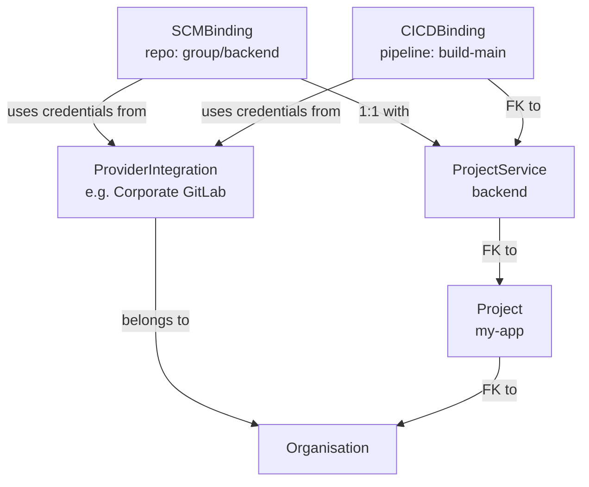

# Integrations Overview

SerOps integrates with log, metric and trace backends, source-control and CI/CD providers. This page is the complete matrix.

## Provider Matrix

### SCM Providers

Source Code Management providers connect your repositories for code change tracking and deployment correlation.

| Provider | Auth Method | Features | Guide |
|----------|-------------|----------|-------|
| **GitLab** | Personal Access Token (`api` scope) | Commits, MRs, pipelines, deployments, webhooks | [Setup](gitlab.md) |
| **GitHub** | Access Token (`repo` scope) | Commits, PRs, Actions, deployments, webhooks | [Setup](github.md) |
| **Azure DevOps** | Personal Access Token | Commits, PRs, pipelines, deployments | [Setup](azure-devops.md) |
| **Bitbucket** | OAuth2 / App Password | Commits, PRs, pipelines | [Setup](bitbucket.md) |

### CI/CD Providers

Build and deployment pipeline providers for tracking deployments and CI/CD logs.

| Provider | Auth Method | Features | Guide |
|----------|-------------|----------|-------|
| **GitLab CI** | Via SCM token | Pipeline status, job logs, deployment events | [Setup](gitlab.md) |
| **GitHub Actions** | Via SCM token | Workflow runs, job logs, deployment events | [Setup](github.md) |
| **Jenkins** | API Token + Base URL | Build status, console logs, pipeline triggers | [Setup](jenkins.md) |
| **Azure Pipelines** | Via SCM token | Pipeline runs, stage logs, deployment events | [Setup](azure-devops.md) |
| **Bitbucket Pipelines** | Via SCM token | Pipeline status, step logs, deployment events | [Setup](bitbucket.md) |

### Observability Providers

Log, metric, and trace providers for fetching application data for AI analysis.

| Provider | Type | Auth Method | Query Language | Guide |
|----------|------|-------------|----------------|-------|
| **Elasticsearch** | Logs | Basic / API Key | ES DSL | [Setup](elasticsearch.md) |
| **OpenSearch** | Logs | Basic Auth | ES DSL | [Setup](opensearch.md) |
| **Grafana Loki** | Logs | Basic / Bearer / Tenant ID | LogQL | [Setup](loki.md) |
| **Splunk** | Logs | Auth Token (bearer) | SPL | [Setup](splunk.md) |
| **Datadog** | Logs + Metrics + Traces | API Key + App Key | Datadog query | [Setup](datadog.md) |
| **AWS CloudWatch** | Logs + Metrics | AWS Credentials | CloudWatch Insights | [Setup](cloudwatch.md) |
| **Google Cloud** | Logs + Metrics | Service Account JSON | GCP filter | [Setup](gcp.md) |
| **Azure Monitor** | Logs + Metrics | Service Principal | KQL | [Setup](azure.md) |
| **Prometheus** | Metrics | Basic / Bearer | PromQL | [Setup](prometheus.md) |
| **VictoriaMetrics** | Metrics | Basic / Bearer | MetricsQL | [Setup](victoriametrics.md) |
| **Grafana Mimir** | Metrics | Basic / Tenant ID | PromQL | [Setup](mimir.md) |
| **Grafana Tempo** | Traces | Basic / Bearer / Tenant ID | TraceQL | [Setup](traces.md) |
| **Jaeger** | Traces | Basic / Bearer | Jaeger query API | [Setup](traces.md) |
| **Zipkin** | Traces | Basic / Bearer | Zipkin query API | [Setup](traces.md) |

!!! note "Traces: push or pull"
    SerOps receives traces natively over **OTLP** — no provider
    integration required. The three trace providers above are **pull**
    adapters for teams that already ship to Jaeger, Zipkin, or Tempo
    and don't want to change their pipeline. Datadog APM works the
    same way via the Datadog integration. See
    [Distributed Traces](traces.md) for both paths.

## Tested environments

Every adapter above has unit tests. Not every one has yet run end to end
against a live system, and this table says which have.

| Area | Status |
|------|--------|
| Self-hosting | Docker Compose and the Helm chart, verified end to end. |
| Kubernetes workloads | Verified on **single-node** clusters (minikube, KinD): Fluent Bit → Elasticsearch, Promtail → Loki, Prometheus with cAdvisor and kube-state-metrics, and OTLP traces. |
| Live-tested backends | Elasticsearch, OpenSearch, Grafana Loki, Prometheus, VictoriaMetrics, Grafana Mimir, GitLab. |
| Managed Kubernetes (EKS, GKE, AKS) | **Not yet validated.** The Kubernetes modes for CloudWatch Container Insights, Cloud Monitoring for GKE and Azure Monitor Container Insights are implemented and unit-tested, but have not run against a live managed cluster. Use the credentials each integration page describes: Google Cloud and Azure deliberately never use the host's own cloud identity (GKE Workload Identity, AKS managed identity), so one organisation on a shared instance cannot borrow it. |
| Multi-node clusters | **Not yet validated.** All the Kubernetes testing above ran on one node. |
| Datadog, AWS CloudWatch, Google Cloud, Azure Monitor | Implemented and unit-tested against mocked API responses; not yet run against a live account. |

If you run SerOps on one of the unvalidated setups, an
[issue](https://github.com/getserops/serops/issues) saying what worked and
what did not is one of the most useful contributions right now.

## How Integrations Work

SerOps uses a two-level integration model:

### Integrations (organisation level)

Credentials are stored once at the organisation level as a **ProviderIntegration**. This enables:

- **Credential reuse** — One token serves multiple services
- **Centralised management** — Rotate tokens in one place
- **Security** — Team members don't need direct access to tokens

### Service Bindings (Service Level)

Each service links to a global integration via **bindings**:

- **SCMBinding** — Links a service to a source code repository (one per service)
- **CICDBinding** — Links a service to CI/CD pipelines (multiple per service)

## Setting Up Integrations

1. **Add an integration**: go to **Integrations → Add Integration**
2. **Add a Service**: Go to your project, click **+ New Service**, and select the integration
3. **Verify**: Run a health check to confirm connectivity
4. **Configure Webhooks** (optional): Set up webhooks for real-time updates

For a complete walkthrough, see [Connect Your First Provider](../how-to/connect-provider.md).

## Related Pages

- [Integrations admin guide](../admin/integrations.md)
- [Observability Providers](observability-overview.md)
- [Integrations API](../api/integrations.md)
