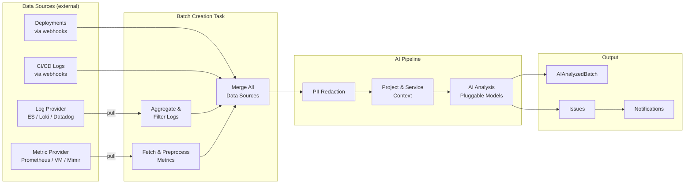

# Batches & Analysis

Batches are the core analysis units in SerOps. Each batch contains logs, metrics, a distributed-trace summary, and AI-generated insights.

## What is a Batch?

A batch is a snapshot of your system at a point in time:

| Field | Description |
|-------|-------------|
| `batch_id` | Unique identifier (e.g., `batch_20260107_143000_a1b2`) |
| `timestamp` | When the batch was created |
| `logs_analyzed` | Number of log entries |
| `issue_count` | Number of issues found |
| `environment` | dev, staging, or production |
| `model_name` | AI model used for analysis |

---

## Batch Creation

Batches are created automatically at a configurable interval (default: every 10 minutes). Each organisation can set its own interval (5 minutes to 12 hours) under **Settings → Data Management → Batch Generation Interval**. See [Batch Generation Interval](../admin/data-retention.md#batch-generation-interval) for details.

### Pipeline Overview



### What Gets Included

| Data Type | Source | Purpose |
|-----------|--------|---------|
| **Application Logs** | Log Provider | Filtered by service + environment |
| **Metrics** | Metric Provider | Raw data for UI visualization |
| **Metrics Summary** | Preprocessed | AI-optimized with anomaly detection |
| **Code Changes** | Deployments | Commits **deployed** (not just committed) |
| **CI/CD Logs** | Log Provider | Pipeline event documents with failure traces |

### Batch Data Structure

The batch stores both raw data (for UI) and preprocessed data (for AI):

```json
{
  "logs": [...],           // Filtered application logs
  "metrics": {...},        // Raw metrics arrays (for charts)
  "metrics_summary": {...}, // Preprocessed metrics (for AI)
  "code_changes": [...],   // Deployed commits with diffs
  "cicd_logs": [...],      // Pipeline logs with traces
  "statistics": {...}      // Aggregated counts
}
```

### What AI Receives

The AI model receives a **formatted text summary**, not raw JSON arrays. This includes **project & service context** (names and descriptions) when available, giving the AI architectural awareness of your system.

```
Project & Service Context:
-------------
Project: "payment-platform" — E-commerce payment processing, Django + PostgreSQL
Services in scope:
  - backend-api [application]: Payment processing API, handles Stripe webhooks
  - redis-cache [infrastructure]: Session and cart caching

System Metrics Summary:
-------------
Memory: 85.7% avg, peak 90.2%, current 88%, trend: STABLE
  Total Memory: 16 GB
  Memory Anomalies: 1 high-usage periods detected
    [2026-01-21T15:30:00Z] 92.5% peak, duration: 3m 0s
      Correlation window: 15:25:00 to 15:35:00

CPU: 45.2% avg, peak 78%, current 42%, trend: STABLE
  (Based on 24 memory and 24 CPU data points)
```

> **Note**: Code changes are linked via **Deployments**, not commit timestamps. This ensures you see what code was actually running when issues occurred.

### CI/CD Trace Display

When a CI/CD job fails, SerOps captures the **full job trace** and displays it in the batch details:

```
[CI/CD] Job "build" failed on branch "develop" (Pipeline #2263666589)

--- Job Output ---
2026-01-14T22:47:50.924Z $ chmod78 644 ~/.ssh/known_hosts
2026-01-14T22:47:50.924Z /bin/sh: chmod78: not found
ERROR: Job failed: exit code 127
```

| Field | Description |
|-------|-------------|
| `trace` | Last 2KB of job output for UI display |
| `error_lines` | Filtered error summary (max 20 lines) for AI analysis |
| `service_name` | Dynamic service name for filtering (e.g., "backend", "frontend") |

### Safeguards

SerOps prevents empty, redundant, or duplicate batches:

| Check | Action |
|-------|--------|
| No services registered | Skip project |
| No data in time window | Skip batch creation |
| No meaningful data for AI | Skip AI call |
| **Duplicate log IDs/messages** | Filtered against previous batches (org-scoped, 30-day lookback) |
| **Repeated log messages** | Time-windowed dedup groups identical errors within 60s |
| **Concurrent task runs** | Distributed lock prevents overlapping batch processing |

---

## Viewing Batches

Navigate to **Data** in the sidebar.

### Batch List

| Column | Description |
|--------|-------------|
| Timestamp | When created |
| Batch ID | Click to view details |
| Project | Parent project |
| Environment | PRODUCTION / STAGING / DEV |
| **Sentinel** | Decision badge — see below |
| Deploys | Deployment count |
| Issues | Count and severity |
| Status | Analyzed, Pending, Failed |

### Sentinel Decision Badges

Each batch shows a colored badge indicating the Sentinel decision:

| Badge | Color | Meaning |
|-------|-------|---------|
| **ALERT** | Red | Real triggers detected (deployment, error spike, anomaly, etc.) — AI analysis ran |
| **ROUTINE** | Amber | Periodic health check — no real triggers, forced by safety net |
| **QUIET** | Green | No triggers — AI skipped (active mode) or ran (shadow mode) |
| **FIRST** | Blue | First batch for this project+environment — AI always runs |
| **SHADOW** | Grey | Evaluated in shadow mode (pre-Sentinel or no decision) |

See [Sentinel How-To](../how-to/sentinel.md) for details on how decisions are made.

### Filtering

- **Project** dropdown
- **Environment** dropdown
- **Search** by batch ID

---

## Batch Details

Click a batch to open the detail view, which features a single log viewer panel. Use the **Data Type** dropdown to switch between:

| Data Type | Description |
|-----------|-------------|
| **Logs** | Application log entries with search and filtering |
| **CI/CD Logs** | Pipeline logs with failure traces |
| **Metrics** | Memory and CPU usage charts |
| **Code Changes** | Deployed commits and file changes |

---

## Re-Analysis

You can re-analyze batches with a different AI model:

1. Select batch(es) via the checkbox in the batch list
2. Click the **Analyze with AI** dropdown button
3. Choose from the dynamically available models

### Model Comparison

To compare results from different models:

1. Select a batch
2. Choose **Compare Model Results** from the dropdown
3. This navigates to the batch detail page in comparison mode, showing side-by-side analysis results

---

## Chat about Batch

Send batch context to AI Chat for deeper analysis:

1. Select a batch
2. Click **Chat about Batch**
3. Ask questions about the batch

The AI will have full context of:
- All logs in the batch
- Detected issues
- Code changes in the time window

---

## Batch Deletion

### Auto-Cleanup

Configure in **Settings → Data Management**:
- Retention period (7-365 days)
- Cleanup frequency (daily/weekly/monthly)

---

## API Reference

### List Batches
```
GET /api/data/batches/?limit=20&offset=0&environment=production&project=demo
```

### Get Batch Details
```
GET /api/data/batches/{batch_id}/
```

### Trigger Analysis
```
POST /api/chat/analyze-batch/
{
  "batch_id": "batch_20260107_143000_a1b2",
  "model": "gemini"
}
```

### Delete Batch
```
DELETE /api/data/batches/{batch_id}/
```

---

## Related Pages

- [Issues](issues.md) — Issues detected within batches
- [AI Chat](ai-chat.md) — Send batch context to AI for deeper analysis
- [Compare AI Models](../how-to/compare-ai-models.md) — Re-analyze with different models
- [Batches API](../api/batches.md) — Full API reference
- [AI API](../api/ai.md) — Analysis and chat endpoints
