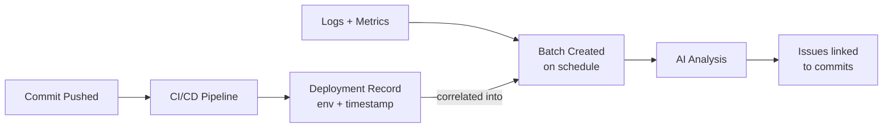

# Code Changes

View commits and code changes associated with a batch.

## Overview

Access from batch detail view by clicking **Code Changes** or navigating to `/dash/code-changes/{batchId}`.

Code changes show commits that were **deployed** during the time window covered by the batch.

> **Key Concept**: SerOps tracks *deployments*, not just commits. This means you see what code was actually running in an environment when issues occurred, not just what was committed.

---

## How Code Changes Are Linked

SerOps uses **deployment-based correlation** rather than commit timestamps:

| Step | Description |
|------|-------------|
| 1. **Commit** | Developer pushes code |
| 2. **Pipeline** | CI/CD pipeline runs |
| 3. **Deployment** | Code deployed to environment (dev/staging/prod) |
| 4. **Tracking** | SerOps records `Deployment` with timestamp + environment |
| 5. **Batch** | Batch queries deployments within its time window |

This approach answers: *"What code was running in Production when this error occurred?"*

---

## Stats Summary

| Stat | Description |
|------|-------------|
| **Total Commits** | Number of commits deployed in batch window |
| **Files Changed** | Total files modified |
| **Additions** | Lines added (green) |
| **Deletions** | Lines removed (red) |

---

## Commit List

Each commit displays:

| Field | Description |
|-------|-------------|
| **SHA** | Short commit hash (clickable) |
| **Branch** | Branch name (badge) |
| **Service** | Service name badge (from ProjectService link) |
| **Message** | First line of commit message |
| **Author** | Commit author name |
| **Deployed At** | When deployed to this environment |
| **Stats** | Files, +additions, -deletions |

---

## Filtering

### Branch Filter
Filter commits by branch:
- **All Branches** (default)
- Individual branches from commits

### Author Filter
Filter by commit author:
- **All Authors** (default)
- Individual authors

---

## Navigation

| Action | Description |
|--------|-------------|
| **Back** | Returns to previous page (batch detail) |
| **Branch Dropdown** | Filter by branch |
| **Author Dropdown** | Filter by author |

---

## Data Source

Code changes are populated via:

1. **SCM Webhooks** - Push events trigger `CodeChange` creation
2. **CI/CD Webhooks** - Pipeline events trigger `Deployment` creation
3. **Deployment Service** - Links deployments to batches

### Provider Support

| Provider | Webhook | Diff Fetch |
|----------|---------|------------|
| GitLab | ✅ Push + Pipeline | ✅ Via API |
| GitHub | ✅ Push | ✅ Via API |
| Azure DevOps | ✅ Push | ✅ Via API |
| Bitbucket | ✅ Push | ✅ Via API |

### Fallback Sync

If webhooks fail, SerOps has automatic fallback:
- **Celery beat** syncs pipelines every 10 minutes
- Fetches recent deployments directly from provider API

---

## Related Pages

- [Analyses](batches.md) — Code changes are displayed within batch details
- [Projects & Services](projects.md) — Configure SCM bindings for code tracking
- [Connect Your First Provider](../how-to/connect-provider.md) — Set up SCM webhooks
- [Integrations Overview](../integrations/overview.md) — Supported SCM and CI/CD providers
- [Projects & Services API](../api/projects.md) — REST API reference
