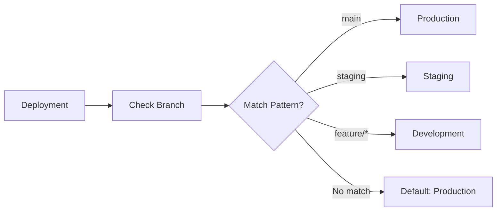

# Environments

SerOps supports multi-environment tracking to analyze dev, staging, and production separately.

## Default Environments

| Environment | Badge | Default Patterns |
|-------------|-------|------------------|
| **Production** | Green | `main, master` |
| **Staging** | Yellow | `staging, release/*` |
| **Development** | Blue | `develop, dev, feature/*` |

---

## How Environment Detection Works



SerOps uses **branch patterns** to determine which environment a deployment belongs to.

---

## Configuring Environments

### Per-Project Settings
 
1. Navigate to **Projects**
2. Click the **Edit** (pencil) icon on a project
3. Scroll to the **Environments** section

### Toggle Environments

Enable/disable environments for each project:

- ✅ **Production** (always recommended)
- ⬜ **Staging** (optional)
- ⬜ **Development** (optional)

### Edit Branch Patterns

Click the edit icon next to an environment:

```
Production: main, master, release/*
Staging: staging, develop, qa
Development: feature/*, fix/*, hotfix/*
```

**Pattern syntax:**
- Exact match: `main`
- Wildcard: `feature/*`
- Multiple: `main, master, release/*`

---

## Custom Environments

Add environments beyond the defaults:

1. Click **+ Add Environment**
2. Enter name (e.g., `qa`, `uat`, `demo`)
3. Set branch patterns
4. Click **Save**

### Examples

| Custom Env | Use Case | Patterns |
|------------|----------|----------|
| `qa` | QA testing | `qa/*` |
| `uat` | User acceptance | `uat, release-candidate/*` |
| `demo` | Sales demos | `demo` |
| `canary` | Canary releases | `canary/*` |

---

## Environment Filtering

### Dashboard

Use the global environment dropdown:
- All environments
- Production only
- Staging only
- Development only

### Data Page

Filter batches by environment:
- Color-coded badges show environment
- Dropdown to filter

---

## Environment Isolation

Data is strictly isolated per environment:

| Data Type | Isolation |
|-----------|-----------|
| Batches | Created per-environment |
| Logs | Filtered by env tag in ES |
| Deployments | Tracked with env field |
| Issues | Linked to env-specific batch |

!!! warning "No Cross-Contamination"
    Production issues never mix with development logs.

---

## Best Practices

!!! tip "Environment Setup"
    1. **Always enable Production** - It's where real issues occur
    2. **Use consistent naming** - Same patterns across projects
    3. **Add QA/UAT if needed** - For complex release pipelines
    4. **Review patterns regularly** - As branching strategy evolves

!!! example "Pattern Examples"
    ```
    # Monorepo with environment branches
    Production: main, production
    Staging: staging, preprod
    Development: develop, feature/*
    
    # GitFlow
    Production: main, master, hotfix/*
    Staging: release/*
    Development: develop, feature/*
    ```

---

## API Reference

### Update Project Environments
```
PATCH /api/projects/{project_id}/
{
  "environments": [
    {
      "name": "production",
      "display_name": "Production",
      "branch_patterns": ["main", "master"],
      "is_active": true
    },
    {
      "name": "staging",
      "display_name": "Staging",
      "branch_patterns": ["staging"],
      "is_active": true
    }
  ]
}
```

### Filter Batches by Environment
```
GET /api/data/batches/?environment=production
```

---

## Related Pages

- [Projects & Services](projects.md) — Configure environments per project
- [Batches & Analysis](batches.md) — Batches are created per environment
- [Issues](issues.md) — Issues are scoped to environments
- [Projects & Services API](../api/projects.md) — REST API reference
