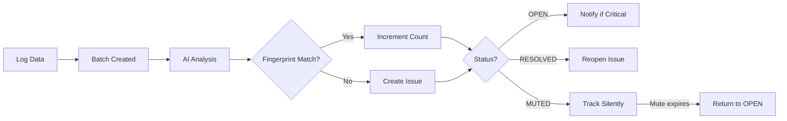

# Issues

Issues are problems detected by AI analysis. Each issue includes severity, root cause, and recommendations. SerOps uses intelligent **deduplication** to prevent duplicate issues across batches.

## Issue Structure

| Field | Description |
|-------|-------------|
| `issue_type` | Category (MEMORY_HIGH, CPU_HIGH, DATABASE_ERROR, etc.) |
| `severity` | CRITICAL, WARNING, INFO |
| `description` | What the issue is |
| `root_cause` | Why it happened |
| `recommendation` | How to fix it |
| `component` | Affected service or infrastructure |
| `error_class` | AI-classified error category (COMMAND_NOT_FOUND, MODULE_NOT_FOUND, etc.) |
| `error_target` | Specific failing item (command name, module name, host:port, etc.) |
| `status` | OPEN, MUTED, RESOLVED |
| `occurrence_count` | How many times this issue was detected |
| `batch` | Parent batch |
| `created_at` | First detection time |
| `last_seen_at` | Most recent occurrence |

---

## Issue Types

SerOps categorizes issues into 25+ types for accurate deduplication:

| Category | Types |
|----------|-------|
| **Performance** | MEMORY_HIGH, CPU_HIGH, DISK_FULL, LATENCY_HIGH, RATE_LIMIT |
| **Errors** | API_ERROR, DATABASE_ERROR, AUTH_FAILURE, PERMISSION_DENIED |
| **Infrastructure** | CONNECTION_TIMEOUT, SERVICE_UNAVAILABLE, DNS_FAILURE |
| **CI/CD** | BUILD_FAILURE, DEPLOY_FAILURE, TEST_FAILURE, CONFIG_ERROR |
| **Security** | SECURITY_ALERT, SSL_CERT_EXPIRY, INVALID_TOKEN |

---

## Component Identification

The **Component** column shows which service or infrastructure is affected:

| Source | Component Value |
|--------|-----------------|
| **Logs** | `service_name` field from log metadata |
| **Code Changes** | `service_name` from the GitLab/GitHub commit data |
| **CI/CD Pipelines** | Pipeline or job name |
| **Memory/CPU Metrics** | `INFRASTRUCTURE` (node-level) |

!!! note "Service Name Configuration"
    The `service_name` is set when logs are shipped via Fluentd/Filebeat. Each registered service in your project should have distinct log labels for accurate component identification.

---

## Severity Levels

| Level | Color | Meaning | Action |
|-------|-------|---------|--------|
| **CRITICAL** | 🔴 Red | System down or data loss risk | Immediate attention |
| **WARNING** | 🟡 Yellow | Performance degradation | Investigate soon |
| **INFO** | 🔵 Blue | Potential improvements | Review when possible |

---

## Viewing Issues

### Issues Page

Navigate to **Issues** in the sidebar.

#### Filters
- **Severity** - Critical, Warning
- **Status** - Open, Muted, Resolved
- **Search** - Keyword search

#### Columns
| Column | Description |
|--------|-------------|
| ID | Issue number (click to copy link) |
| Description | Issue summary with severity icon |
| Severity | Color-coded badge (CRITICAL, WARNING, INFO) |
| Status | Colored dot indicator (hover for label) |
| Age | Time since issue was first detected |
| Actions | Three-dot dropdown menu with View Details, Resolve, Mute, Reopen |

All columns are sortable by clicking the column header.

> **Hidden by default:** Type, Correlations (use Columns dropdown to show)

#### UI Features

| Feature | Description |
|---------|-------------|
| **Summary Stats Bar** | Shows severity counts (X Critical, Y Warning) and status counts (X Open, Y Muted, Z Resolved) at top for quick overview |
| **Severity Stripe** | Each row has a colored left border matching severity (red=Critical, orange=Warning) |
| **Column Visibility** | Click "Columns" dropdown to show/hide columns |
| **Correlation Badges** | Shows 📊 memory/cpu or 🔗 commit badges when issue correlates with metrics or code changes |

### Batch Issues View

Click **Issues** count in the Data page to see issues for that specific batch.

---

## Issue Deduplication

SerOps uses **fingerprint-based deduplication** to prevent duplicate issues while ensuring different errors create separate issues. The system is hardened with database-level constraints and atomic operations for correctness under concurrent access.

### How It Works

1. **Fingerprint Generation**: Each issue gets a unique fingerprint (SHA-256) based on:
   - Issue type (MEMORY_HIGH, CPU_HIGH, etc.)
   - Scope (SERVICE, INFRASTRUCTURE, PIPELINE)
   - Component (normalized service name)
   - Environment (dev, staging, production)
   - **Error Class** (v3) - AI-classified error category
   - **Error Target** (v3) - Specific failing item

2. **AI Error Classification**: The AI analyzes error messages and classifies them:

| Error Class | Description | Example Target |
|-------------|-------------|----------------|
| `COMMAND_NOT_FOUND` | Missing command or binary | `chmod9`, `npm` |
| `MODULE_NOT_FOUND` | Missing library/package | `pandas`, `redis` |
| `SYNTAX_ERROR` | Code or config syntax error | `line 42` |
| `CONNECTION_REFUSED` | Network connection refused | `redis:6379` |
| `CONNECTION_TIMEOUT` | Network timeout | `api.example.com` |
| `AUTH_FAILED` | Authentication failure | `oauth_service` |
| `PERMISSION_DENIED` | Access denied | `/etc/config` |
| `OUT_OF_MEMORY` | Memory exhaustion | `worker-pod` |
| `TEST_ASSERTION` | Test failure | `test_login` |
| `OTHER` | Unclassified | N/A |

3. **Tiered Matching**: When a new issue is detected:
   - **Exact match found** → Increment `occurrence_count`, update `last_seen_at`
   - **Same type, different error** → Create new issue (e.g., `chmod9` vs `chmod10`)
   - **Infrastructure promotion** → Match if same type exists in INFRASTRUCTURE scope
   - **No match** → Create new issue

4. **Status Handling**:
   - RESOLVED issues are reopened if same fingerprint detected again
   - MUTED issues continue tracking (count increases, no alerts)
   - Severity escalates if a new occurrence has higher severity (e.g., WARNING → CRITICAL)

### Concurrency Guarantees

Issue deduplication is safe under concurrent access from multiple Celery workers:

| Mechanism | Purpose |
|-----------|---------|
| **Partial Unique Constraint** | Database enforces at most one OPEN/MUTED issue per fingerprint+project |
| **Row-Level Locking** | `select_for_update()` prevents lost updates to `occurrence_count` |
| **Atomic Increments** | `F('occurrence_count') + 1` ensures no count is lost even under high contention |
| **IntegrityError Retry** | If two workers race to create the same issue, the loser retries and finds the winner's row |
| **Distributed Task Locks** | Cache-based locks prevent overlapping batch processing runs |

### Example

```
chmod9 not found    → COMMAND_NOT_FOUND:chmod9   → Issue #1 (count: 1)
chmod9 not found    → COMMAND_NOT_FOUND:chmod9   → Issue #1 (count: 2) ✓ Deduped
chmod10 not found   → COMMAND_NOT_FOUND:chmod10  → Issue #2 ✓ NEW (different target)
npm not found       → COMMAND_NOT_FOUND:npm      → Issue #3 ✓ NEW (different target)
pandas missing      → MODULE_NOT_FOUND:pandas    → Issue #4 ✓ NEW (different class)
```

!!! tip "Why This Matters"
    Previously, all "command not found" errors would group together. Now, typos like `chmod9` vs `chmod10` create separate issues, so you get alerted about each distinct problem.

---

## Issue Actions

Actions are available via the **three-dot dropdown menu** on each issue row.

### View Details

Open the issue detail view for deeper analysis:
1. Select **View Details** from the dropdown (or click the issue row)
2. See full root cause, recommendations, and correlated data
3. Ask follow-up questions via AI Chat

### Resolve

Mark an issue as fixed:
1. Select **Resolve** from the dropdown (OPEN issues only)
2. Issue status changes to RESOLVED
3. If the same issue recurs, it will be reopened automatically

!!! tip "Resolution quality feeds future AI analyses"
    When **Recent Resolutions Context** is enabled (Settings → Data Management), the `root_cause` text on resolved issues is passed to the AI as diagnostic context for new batches in the same project. A descriptive root cause (a sentence or two) becomes useful institutional memory; one-word resolutions like "fixed" are filtered out. See [Recent Resolutions Context](../admin/issue-settings.md#recent-resolutions-context) for the full configuration.

### Mute

Suppress notifications for a period:
1. Select **Mute** from the dropdown (OPEN issues only)
2. Select duration: 1 day, 7 days, 30 days, 90 days, or Forever
3. Issue status changes to MUTED

!!! info "Muted Issue Behavior"
    - Muted issues remain visible in the issues list with a "Muted" badge
    - New occurrences increment the count but don't trigger alerts
    - Muted issues are NOT hidden by default

### Reopen

Bring back a resolved or muted issue:
1. Select **Reopen** from the dropdown (MUTED or RESOLVED issues)
2. Issue status changes back to OPEN
3. Normal alert behavior resumes

---

## Bulk Actions

Select multiple issues using the checkbox on each row to enable bulk operations:

| Action | Description |
|--------|-------------|
| **Resolve N** | Resolve all selected issues |
| **Mute N** | Mute all selected issues |
| **Reopen N** | Reopen all selected issues |
| **Clear** | Clear the current selection |

A bulk toolbar appears at the top of the list when issues are selected.

---

## Keyboard Shortcuts

The Issues page supports keyboard navigation for power users:

| Shortcut | Action |
|----------|--------|
| `j` / `k` | Navigate down / up through issue rows |
| `v` | View details of focused issue |
| `r` | Resolve focused issue |
| `m` | Mute focused issue |
| `x` | Toggle selection of focused issue |
| `?` | Show keyboard shortcuts help |

---

## Issue Lifecycle



---

## Notification Triggers

Issues can trigger notifications based on status:

| Status | Severity | Notification |
|--------|----------|--------------|
| OPEN | CRITICAL | ✅ Yes (Email, Slack, Teams) |
| OPEN | WARNING | ⚠️ Optional |
| MUTED | Any | ❌ No |
| RESOLVED | N/A | ❌ No |

Configure in **Settings → Delivery Channels** and **Settings → Routing Rules**.

---

## Best Practices

!!! tip "Issue Management"
    1. **Review Critical Daily** - Don't let critical issues accumulate
    2. **Use AI Chat** - Get detailed remediation steps
    3. **Track Patterns** - High occurrence count indicates systemic problems
    4. **Mute Noise** - Mute known issues during maintenance windows
    5. **Resolve Promptly** - Resolve fixed issues to keep the list clean

!!! warning "Common Pitfalls"
    - Ignoring WARNING issues (they often become CRITICAL)
    - Muting forever without follow-up
    - Not checking high occurrence counts (indicates recurring problems)

---

## Related Pages

- [Batches & Analysis](batches.md) — Batches that produce issues
- [AI Chat](ai-chat.md) — Send issues to AI for deeper analysis
- [Notifications](notifications.md) — Get alerted when issues are detected
- [Tune Issue Deduplication](../how-to/tune-deduplication.md) — Configure dedup windows and auto-resolve
- [Issue Settings](../admin/issue-settings.md) — Organisation-wide issue configuration
- [Issues API](../api/issues.md) — REST API reference
