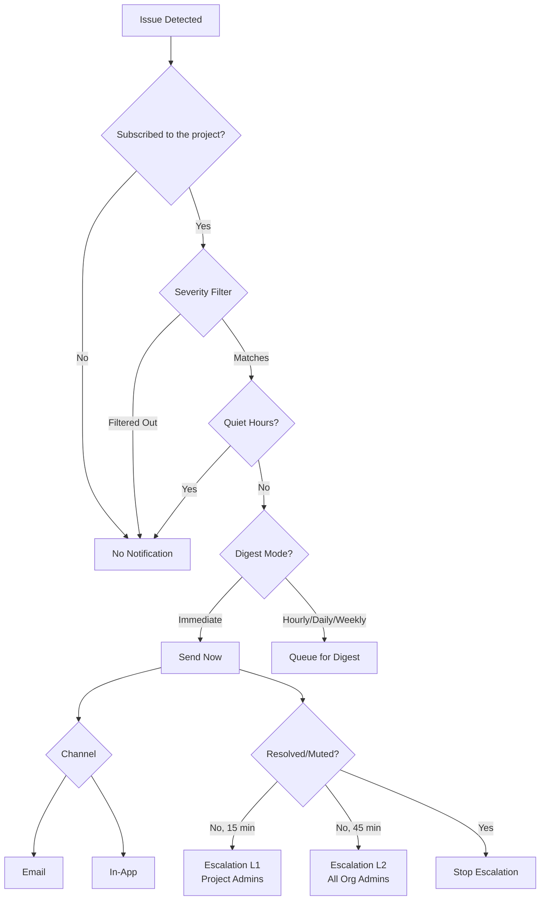

# Notification System

SerOps provides a comprehensive notification system designed to keep you informed about critical issues without overwhelming your inbox. This guide explains how to configure your preferences, manage subscriptions, and understand internal escalation rules.

## Notification Lifecycle

---

## User Preferences

Each user can fully customize how and when they receive notifications. Access your settings via **User Avatar dropdown > Notifications**.

### Channels
- **Email**: Receive alerts via your registered email address.
- **In-App**: See notifications in the SerOps dashboard bell icon.

!!! note "Personal versus organisation-wide"
    The preferences on this page control *your* delivery. Slack, Teams,
    PagerDuty, Opsgenie and shared mailboxes are organisation-wide and configured
    by an admin under **Alerts & routing → Delivery Channels**, with
    **Alerts & routing → Routing Rules** deciding which incidents reach them.
    See [Notifications](../admin/notifications.md).

### Severity Filters
You can choose which types of issues trigger a notification. Both your
choice here and the project subscription's must match:
- **Critical** (Default: ON): Service-impacting outages or failures.
- **Warning** (Default: ON): Performance degradation or potential risks.
- **Info** (Default: OFF): General system updates and logs.

### Quiet Hours
To prevent burnout, you can configure **Quiet Hours**:
- Notifications generated during this window are **suppressed**: they are
  not sent later. The issue stays on the dashboard and in team channels.
- You can set your specific Timezone.

---

## Batched Digests

Instead of receiving an email for every single event, you can opt for **Digests**:
- **Immediate**: Receive alerts as they happen.
- **Hourly**: One email at the top of each hour.
- **Daily**: One email at 09:00 in your time zone.
- **Weekly**: One email on Monday at 09:00 in your time zone.

Digest frequency applies to every severity, critical included. For on-call
paging, use an organisation [delivery channel](../admin/notifications.md)
(PagerDuty, Opsgenie, Slack) rather than a personal digest.

Digest emails include:
- Summary statistics (X Critical, Y Warning)
- List of affected projects
- Direct links to the dashboard

---

## Project Subscriptions

Personal notifications are **opt-in**: you receive them only for projects you
subscribe to. Unsubscribing stops all personal notifications for that project.
Subscriptions stop automatically when your account is deactivated or leaves
the organisation.

To manage subscriptions:
- Go to **Notification Preferences > Project Subscriptions**.
- Use the "Subscribe to Project" dropdown to re-subscribe.
- Click the **Trash Icon** to unsubscribe.

---

## Escalation Rules (Automated)

For **Critical Issues** that are not acknowledged, SerOps enforces an automatic escalation policy to ensure coverage.

### Hierarchy
Escalation follows a role-based path:
1.  **Level 1 (15 min)**: Notifies **Project Admins** (Admins who are members of the affected project).
2.  **Level 2 (45 min)**: Notifies **All Organization Admins** (Safety net for the entire org).

### Stopping Escalation
Escalation is an automated backend process. To stop escalation, resolve or mute the issue:
1.  Click "View Issue" in the email or dashboard notification.
2.  Resolve or mute the issue from the issue detail page.
3.  This stops further escalation notifications to your team.

---

## Unsubscribe Links
All email notifications include a direct `Manage Preferences | Unsubscribe` link in the footer, allowing you to quickly tune your settings if an alerting source becomes too noisy.

---

## Related Pages

- [Issues](issues.md) — Issues that trigger notifications
- [Configure Quiet Hours](../how-to/quiet-hours.md) — Step-by-step quiet hours setup
- [Set Up Escalation Rules](../how-to/escalation-rules.md) — Configure escalation tiers
- [Admin Notifications](../admin/notifications.md) — Organisation-wide notification settings
- [Notifications API](../api/notifications.md) — REST API reference
