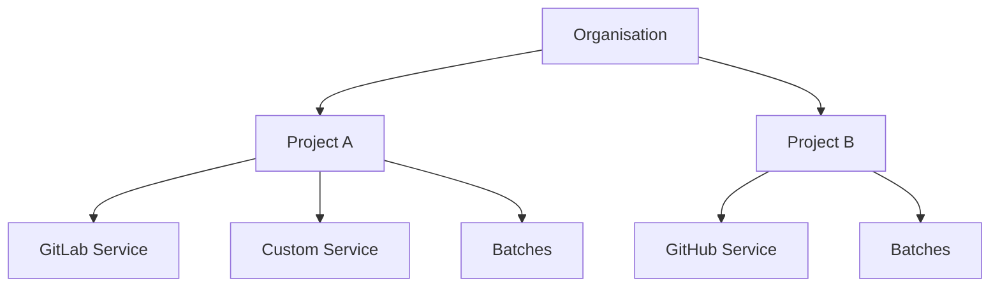

# Projects

Projects organize your services and provide the context for log analysis.

## Project Structure

| Field | Description |
|-------|-------------|
| `name` | Project name |
| `description` | Purpose and tech stack (max 500 chars). Passed to AI for better analysis. |
| `environments` | Enabled environments with patterns |
| `services` | Connected GitLab/GitHub/Azure services |
| `batches` | Analysis batches |

---

## Creating a Project

1. Navigate to **Projects** in sidebar
2. Click **+ New Project**
3. Fill in:
   - **Name** - Project identifier
   - **Description** - Describe your project's purpose and tech stack (max 500 characters). This context is passed to AI during batch analysis, helping it produce more accurate root cause explanations.
   - **Environments** - Toggle dev/staging/prod

!!! tip "Writing Good Descriptions"
    Include the project's purpose, main technologies, and key dependencies. Example: *"E-commerce platform — Django backend, React frontend, PostgreSQL, Redis caching, Stripe payments."* The AI uses this to correlate issues with your specific architecture.

### Environment Configuration

For each environment, configure branch patterns:

| Environment | Default Pattern | Example Branches |
|-------------|-----------------|------------------|
| Production | `main, master` | main, master |
| Staging | `staging, release/*` | staging, release/v1.2 |
| Development | `develop, dev, feature/*` | develop, dev, feature/auth |

!!! tip "Custom Environments"
    Add custom environments like `qa`, `uat`, `demo` via the **+ Add Environment** button.

---

## Adding Services
 
Services connect your Git providers, infrastructure, or custom components to SerOps.
 
### The Add Service Wizard

SerOps uses a step-by-step wizard to guide you through service creation.

1. Click **+ New Service** to open the wizard.

#### Step 1: Choose Service Type
Select the type of service you are adding:

*   **Application**: Connects to a Git repository (GitLab, GitHub, etc.) for code, CI/CD, and deployment tracking.
*   **Infrastructure**: For non-code services (Databases, Caches, Message Queues).
*   **Custom**: For manual integrations or external services.

#### Step 2: Configure Details

**For Applications:**
1.  **Code Repository Provider**: Select your provider (e.g., GitLab).
2.  **Integration**: Choose from your configured integrations.
3.  **Repository**: Select the repository from the dropdown.
    *   *Note*: The **Service Name** will automatically populate with the repository name (e.g., choosing `group/docs` sets name to `docs`). You can customize this if needed.

**For Infrastructure:**
1.  **Type**: Database, Cache, Message Queue, or Load Balancer.
2.  **Provider**: AWS, GCP, Azure, or Self-Hosted.
3.  **Name & Description**: Define identifiers for the service.

#### Step 3: CI/CD (Optional)
For Application services, you can optionally configure CI/CD pipeline tracking:
1.  **Skip**: Keep "Skip for now" selected if you don't need pipeline tracking.
2.  **Add**: Select "Yes, set up CI/CD pipeline", choose the provider, and link the integration.

Click **Create Service** to finish.

---

## Managing Projects

You can edit or delete projects directly from the project list.

### Editing a Project

1. Click the **Edit** (pencil) icon in the Actions column
2. Modify:
   - **Name** & **Description**
   - **Environments** (Enabled/Disabled, Patterns)
   - **Branch Patterns**
3. Click **Update Project**

### Deleting a Project

!!! danger "Irreversible Action"
    Deleting a project will permanently remove:
    - The project configuration
    - All associated batches and analysis history
    - Metrics and logs links

1. Click the **Delete** (trash) icon in the Actions column
2. A confirmation modal will appear
3. Confirm deletion

### Environment Configuration

Inside the Edit modal, you can:
- **Enable/Disable** environments (Dev, Staging, Prod)
- **Edit Patterns** (e.g., set `staging` branch for Staging env)
- **Add Custom Environments** (e.g., `qa`, `demo`)

---

## Service Details

Click a service to see:

| Field | Description |
|-------|-------------|
| **Type** | GitLab, GitHub, Azure DevOps |
| **Name** | Service name |
| **Status** | Active, Inactive |

---

## Best Practices

!!! tip "Project Organization"
    1. **One project per application** - Don't mix unrelated services
    2. **Use meaningful names** - `payment-api` not `project-1`
    3. **Configure all environments** - Get complete visibility
    4. **Set branch patterns** - Accurate environment detection

!!! warning "Common Mistakes"
    - Creating projects without services (no data to analyze)
    - Wrong branch patterns (logs go to wrong environment)
    - Expired access tokens (data stops syncing)

---

## Related Pages

- [Environments](environments.md) — Configure branch patterns per environment
- [Connect Your First Provider](../how-to/connect-provider.md) — End-to-end provider setup
- [Set Up Infrastructure Services](../how-to/infrastructure-services.md) — Database, cache, and queue services
- [Integrations Overview](../integrations/overview.md) — All supported SCM, CI/CD, and observability providers
- [Projects & Services API](../api/projects.md) — REST API reference
